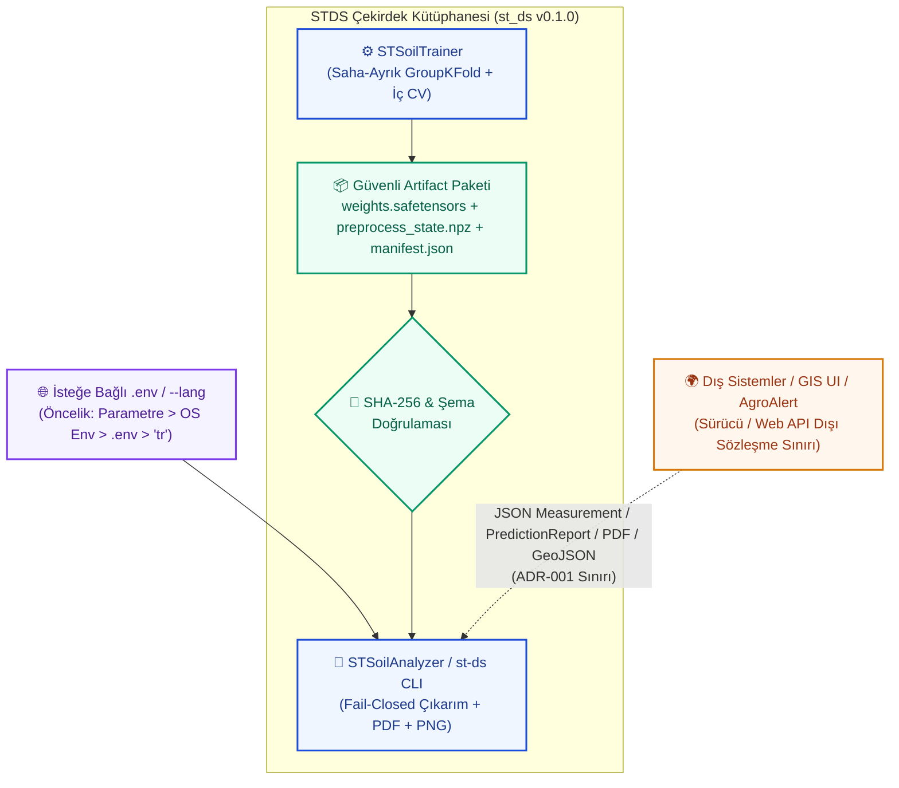
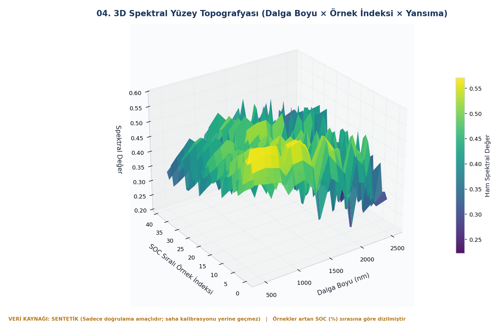
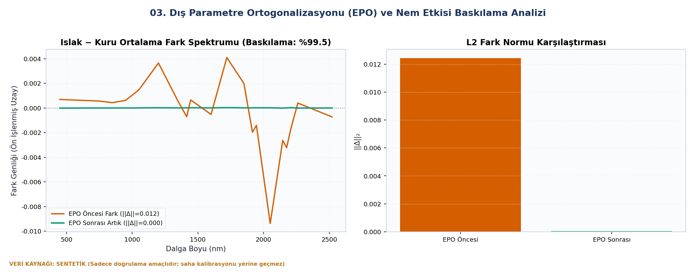
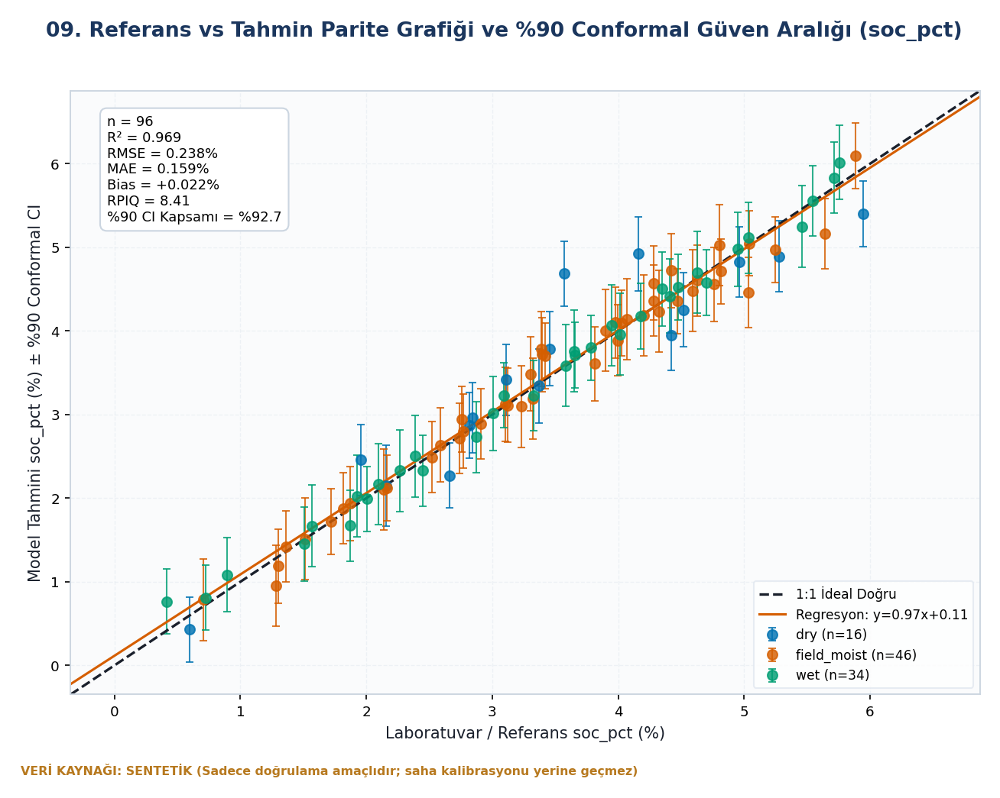
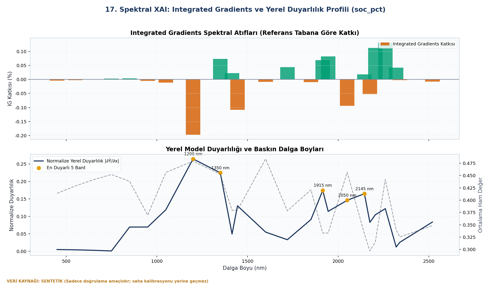
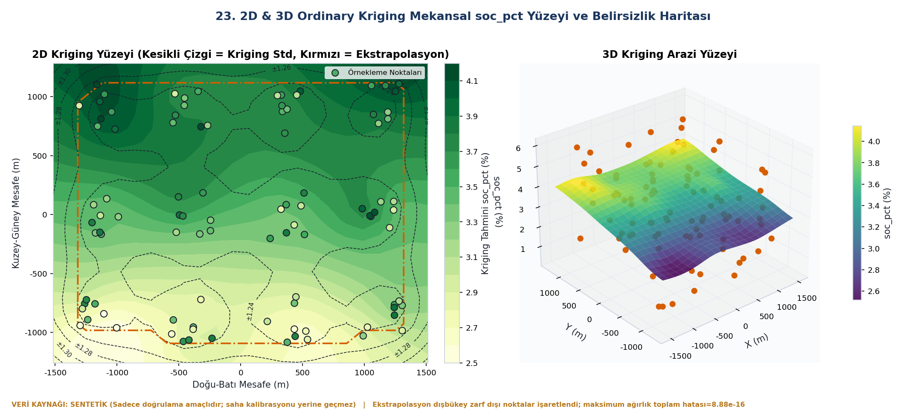
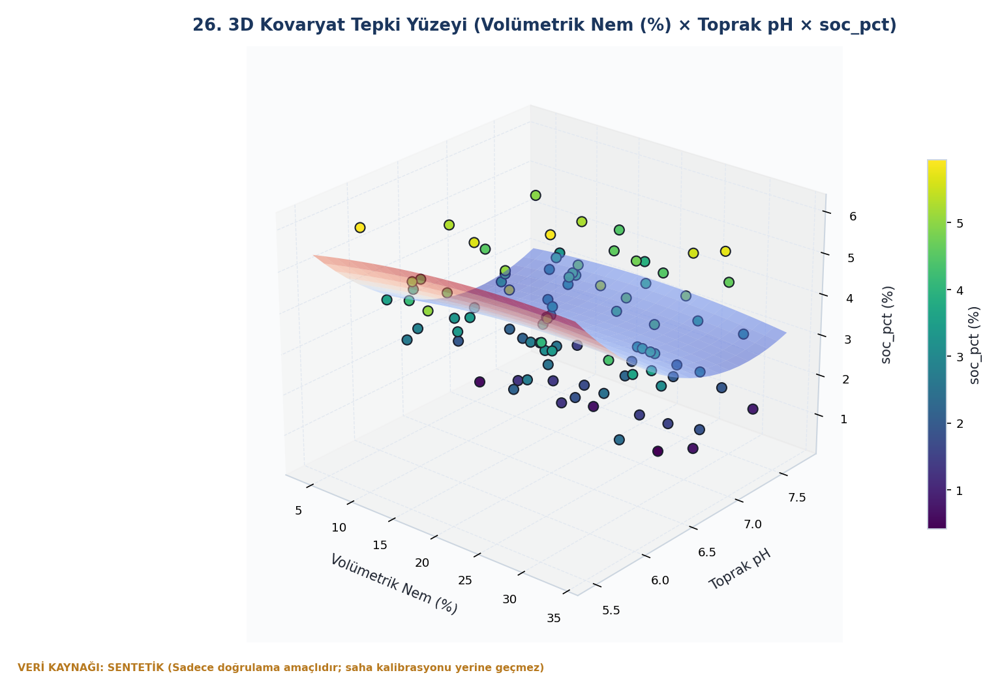

<div align="center">


# SpaceTeknopoliDataScience (`st-ds`) — MVP `v0.1.0`

**Çok Sensörlü Toprak Spektroskopisi İçin Bağımsız, Deterministik, Çift Dilli (`TR` / `EN`) ve Açıklanabilir Karbon Analitik Motoru**

-1B365D?style=for-the-badge&logo=semanticrelease&logoColor=white)

_%7C_EN_(.env)-8B5CF6?style=for-the-badge)

-059669?style=for-the-badge)
-D97706?style=for-the-badge&logo=gnubash&logoColor=white)

<br/>

**[🇹🇷/🇬🇧 Toprak Analiz Rehberi](docs/TOPRAK_ANALIZ.md)** • **[🚀 İlk Kurulum Yol Haritası](docs/FIRST_TIME_ROADMAP_GUIDE.md)** • **[🎓 Akademik Metodoloji](docs/ACADEMIC_METHODOLOGY_AND_ALGORITHMS.md)** • **[⚙️ Sistem & API Rehberi](docs/SYSTEM_AND_USAGE_GUIDE.md)** • **[🧪 Sentetik Test](docs/SYNTHETIC_TESTING_GUIDE.md)** • **[📋 Sürüm Notları](docs/RELEASE_NOTES.md)**

</div>

---

> [!TIP]
> **Tek Komutla Başlayın (Türkçe veya İngilizce + Tam PDF + 26+ PNG):**
> ```bash
> # Varsayılan Türkçe çıktı (zaman damgalı runs/<TARİH>_full_run/ klasörüne yazar)
> bash scripts/03_run_full_pipeline.sh
>
> # Veya .env içinden STDS_LANG=en yapın ya da parametreyle anında İngilizce çalıştırın:
> STDS_LANG=en bash scripts/03_run_full_pipeline.sh
> ```

**`st-ds`**, toprak spektrumlarını (**Vis-NIR / SWIR / FT-NIR / Çoklu Bant LED / LIBS**) ve fizikokimyasal eş değişkenleri (**EIS**, hacimsel nem $\theta_v$, $\mathrm{pH}$, sıcaklık, elektriksel iletkenlik, hacim ağırlığı $\rho_b$) alarak **Organik Karbon (SOC)**, **İnorganik Karbon (SIC)**, **Toplam Karbon (TC = SOC + SIC)** ve **Fiziksel Karbon Stokunu ($\mathrm{Mg\;C\;ha^{-1}}$)**; dağılım-bağımsız Conformal belirsizlik aralıkları, alan dışı (**OOD**) güvenlik kapısı, bilimsel açıklanabilirlik (**XAI**), **Ordinary Kriging** haritaları ve **tüm PNG'leri içeren çok sayfalı PDF raporlarıyla** üreten bağımsız Python kütüphanesi ve CLI aracıdır.

---

## Renkli Sistem Mimarisi ve Veri Akışı

### 1. Ham Sensör Sinyalinden Karbon Stokuna ve Çok Sayfalı PDF Raporuna

```mermaid
flowchart LR
    classDef inputNode fill:#EFF6FF,stroke:#1D4ED8,stroke-width:2px,color:#1E3A8A
    classDef procNode fill:#ECFDF5,stroke:#059669,stroke-width:2px,color:#065F46
    classDef modelNode fill:#FFF7ED,stroke:#D97706,stroke-width:2px,color:#9A3412
    classDef guardNode fill:#FEF2F2,stroke:#DC2626,stroke-width:2px,color:#991B1B
    classDef outNode fill:#F5F3FF,stroke:#7C3AED,stroke-width:2px,color:#4C1D95

    A["🌱 Ham Ölçüm<br/>(Spektrum + EIS + Kovaryat)"]:::inputNode --> B["📏 Alan & Birim Sözleşmesi<br/>(UnitRegistry + InstrumentProfile)"]:::inputNode
    B --> C["🔬 Radyometri & Sinyal QC<br/>(Dark/White, ISS, ArPLS, Pseudo-Voigt)"]:::procNode
    C --> D["🧪 Kemometrik Zincir<br/>(Absorbance → SNV → Fiziksel SG → EPO/GLSW)"]:::procNode
    D --> E["🧬 İsimlendirilmiş Füzyon<br/>(Vis-NIR Bantlar + EIS + Eksik İşaretçi)"]:::procNode
    E --> F["🧠 Model Katmanı (ADR-005)<br/>(PLSR / KRR / RF / MBL / HybridNet)"]:::modelNode
    F --> G["🛡️ Conformal CI90 & OOD<br/>(Mahalanobis + k-NN + Zarf)"]:::guardNode
    F --> H["🔍 Bilimsel XAI (ADR-006)<br/>(Duyarlılık, IG, HSIC B≥4, 2. Türev)"]:::modelNode
    G --> I["⚖️ Karbon Kapatma & Stok<br/>(TC=SOC+SIC, Taylor σ_S)"]:::guardNode
    I --> J["📊 26 PNG + HTML Pano + Çok Sayfalı PDF<br/>(Ordinary Kriging + CSV/MD + TR/EN)"]:::outNode
```



### 2. Sıfır-Pickle Güvenlik Sınırı & Çift Dilli Konfigürasyon (`ADR-001` & `.env`)



---

## Hazır Bash İş Akışları (`scripts/` → Zaman Damgalı `runs/`)

Sistemi tek tek kod yazmadan uçtan uca anlamak ve kendi verilerinizle hemen sonuç almak için `scripts/` altındaki açıklamalı bash betiklerini kullanabilirsiniz. Tüm çıktılar `.gitignore` tarafından hariç tutulan zaman damgalı **`runs/<YYYYMMDD_HHMMSS>_*/`** klasörlerine yazılır:

| Betik | Ne Yapar? | Çıktı Klasörü & Üretilen Dosya Türleri |
| --- | --- | --- |
| **`bash scripts/01_generate_synthetic_data.sh`** | Gerçekçi sentetik toprak spektrumu (`JSON` + `CSV` + `.meta.json`), eşleşmiş **Islak/Kuru EPO çiftleri**, kalite profili üretir ve doğrular | `runs/<TS>_synthetic_data/` (`*.json`, `*.csv`, `data_profile.json`, `validation_report.json`) |
| **`bash scripts/02_train_and_evaluate.sh [veri]`** | Veri doğrulama → `fit-epo` → `evaluate` (CV) → `train` (imzalı `.safetensors`) → `artifact inspect` + **Eğitim Özet PDF'i** | `runs/<TS>_train_eval/` (`artifact_bundle/`, `03_cv_benchmark.json`, `04_training_summary.pdf`) |
| **`bash scripts/03_run_full_pipeline.sh [veri]`** | Girdi → İşleme → Tahmin & XAI → Raporlama → Görselleştirme aşamalarının tamamını çalıştırıp **TÜM PNG'li Ana PDF** üretir | `runs/<TS>_full_run/` (**`00_STDS_FULL_ANALYSIS_REPORT.pdf`**, **`04_predictions_report.pdf`**, 26 PNG, 5 CSV/MD, 3D HTML, `index.html`) |

---

## İsteğe Bağlı `.env` & Çift Dilli (`TR` / `EN`) + PDF Dışa Aktarım

Proje kökünde varsayılan Türkçe ayarlı **`.env`** ve referans **`.env.example`** dosyaları bulunur (git tarafından takip edilir). Sistem `.env` dosyasına **bağımlı değildir** — dosya silinse bile varsayılan `tr` ile çalışmaya devam eder:

```env
# .env örneği (TR varsayılan; ENG kullanıcıları için STDS_LANG=en yapabilirsiniz)
STDS_LANG=tr
STDS_RUNS_DIR=runs
STDS_DPI=160
STDS_PDF_EXPORT=true
```

- **CLI Parametresiyle Anlık Değiştirme:** `st-ds visualize --input veri.json --output rapor --lang en` (`.env` ve ortam değişkenini geçersiz kılar)
- **Çıkarım & Raporlamada Doğrudan PDF:**
  - `st-ds train ... --pdf runs/egitim_ozeti.pdf --lang tr`
  - `st-ds predict ... --include-xai --pdf runs/tahmin_raporu.pdf --lang en`
  - `st-ds report export --input predictions.json --output out.json --format both --lang tr`
  - `st-ds visualize ...` (otomatik olarak `reports/stds_analysis_report.pdf` + `index.html` + `26+ PNG` + `5 CSV/MD` üretir)

---

## Görsel Şölen — Bilimsel Çıktı ve 2D / 3D Analitik Galeri (`st_ds.visualization`)

`st_ds.visualization` motoru tek komutla (`st-ds visualize`) **26 adet 2D/3D bilimsel grafik**, **5 adet CSV/Markdown denetim tablosu**, **etkileşimli 3D Plotly HTML sahneleri**, **çevrimdışı `index.html` panosu** ve **tüm PNG'leri içeren çok sayfalı PDF analitik raporu** üretir:

> [!NOTE]
> **Kanıt Sınırı (`Risk 9`):** Aşağıdaki vitrin grafiklerinin tamamı boru hattının matematiksel kapanışını göstermek üzere deterministik **`SyntheticGeneratorV2` (`seed=42`, `n=96`, 12 saha)** sentetik veri setiyle üretilmiştir; gerçek tarla/laboratuvar kalibrasyon performansı yerine geçmez.

<table>
  <tr>
    <td width="50%" align="center">
      <br/>
      <b>1. 3D Spektral Yüzey Topografyası (Dalga Boyu × Örnek İndeksi × Yansıma)</b><br/>
      <sub>Artan SOC (%) sırasına göre sıralanmış çoklu bant spektral tepki yüzeyi ve su/karbonat çukurları.</sub>
    </td>
    <td width="50%" align="center">
      <br/>
      <b>2. Dış Parametre Ortogonalizasyonu (EPO) ile Nem Bastırma</b><br/>
      <sub>Eşleşmiş ıslak–kuru fark spektrumunda parazit nem normunun ortogonal bastırılması (<code>DEF-001</code> uzay imzalı).</sub>
    </td>
  </tr>
  <tr>
    <td width="50%" align="center">
      <br/>
      <b>3. Referans vs. Tahmin Paritesi ve %90 Conformal Güven Bandı</b><br/>
      <sub>Nem rejimlerine göre renklendirilmiş grup-dışı (OOF) kestirim ve kalibreli <code>CI90</code> hata çubukları.</sub>
    </td>
    <td width="50%" align="center">
      <br/>
      <b>4. Bilimsel XAI: Integrated Gradients &amp; Ölçek-Normalize Duyarlılık</b><br/>
      <sub>Tanısal organik/su bantlarındaki pozitif/negatif atıflar ve baskın dalga boyu tepe noktaları.</sub>
    </td>
  </tr>
  <tr>
    <td width="50%" align="center">
      <br/>
      <b>5. 2D &amp; 3D Ordinary Kriging Karbon Yüzeyi ve Delaunay Sınırı</b><br/>
      <sub>Matheron variogramı tabanlı kriging tahmini, ±std konturları ve dış bükey örtü ekstrapolasyon maskesi.</sub>
    </td>
    <td width="50%" align="center">
      <br/>
      <b>6. 3D Kovaryat İlişki Yüzeyi (Volümetrik Nem × Toprak pH × SOC)</b><br/>
      <sub>Çevresel eş değişkenlerin karbon gradyanıyla ortak çok boyutlu yüzey ve saçılım dağılımı.</sub>
    </td>
  </tr>
</table>

---

## Temel Mimari Kazanımlar & Kapatılan Kritik Kusurlar

| Karar / Kusur | Çözülen Bilimsel veya Güvenlik Problemi | STDS `v0.1.0` Karşılığı |
| --- | --- | --- |
| **`ADR-002`** | Sabit 24 bant varsayımı ve birimsiz ham sayı listeleri | Dinamik `InstrumentProfile` + fail-closed `UnitRegistry` (`%C`, `g/cm³`, `nm`, `Ω`) |
| **`DEF-001`** | `EPO.fit` ile `EPO.transform` arasında farklı ön-işleme uzayı | SHA-256 `space_signature` kilidi; uyuşmazlıkta anında `CalibrationError` |
| **`DEF-002`** | Eşit olmayan dalga boylarında indeks bazlı hatalı Savitzky–Golay türevi | Fiziksel $\Delta\lambda$ (nm) ölçekli kaydırılmış Vandermonde polinom türevi |
| **`DEF-003`** | Tekrar taramaların ve aynı sahanın train/test içine sızması | `GroupedSplitBuilder` (`site_id`/`sample_id`) + kat-içi (`fold-only`) fit/transform |
| **`DEF-005`** | Eksik `bulk_density` yerine sessizce `1.35 g/cm³` varsayılması | Eksik $\rho_b$'de stok asla hesaplanmaz (`stock_mg_ha = None`, `MISSING_BULK_DENSITY`) |
| **`DEF-006`** | Güvensiz `.pkl` / keyfi kod çalıştıran `torch.load` serileştirmesi | Sıfır-pickle `.safetensors` + `.npz` + SHA-256 doğrulamalı `manifest.json` |
| **`ADR-006`** | Birimce uyumsuz ham gradyan ve iki max gradyan çarpımından XAI etkileşimi | Ölçek-normalize IG, $B<4$ korumalı RBF-HSIC ve gerçek 2. derece karışık kısmi türev |

---

## 30 Saniyede Başlangıç (Kurulum, İlk Test, CLI ve PDF)

```bash
# 1) Paketi yerel olarak kurun (opsiyonel etkileşimli 3D/seaborn için ".[viz,dev]")
/opt/anaconda3/bin/pip install --no-build-isolation --no-deps -e .

# 2) Tüm test paketini çalıştırın
/opt/anaconda3/bin/pytest tests/ -v

# 3) Uçtan uca tam boru hattını (PDF + 26 PNG + CSV/MD + HTML) zaman damgalı runs/ altına çalıştırın
bash scripts/03_run_full_pipeline.sh
```

```text
st-ds dataset validate     ──► Kanonik şema, birim ve sentetik/gerçek kaynak denetimi
st-ds calibration fit-epo  ──► Eşleşmiş wet/dry verilerden space_signature mühürlü EPO fit
st-ds evaluate             ──► Saha-ayrık GroupKFold katlarında tüm modelleri kıyaslama
st-ds train [--pdf ...]    ──► Sızıntısız eğitim + Conformal/OOD kalibrasyonu + .safetensors + PDF özeti
st-ds artifact inspect     ──► SHA-256 bütünlük doğrulama + Model Card & Manifest inceleme
st-ds predict [--pdf ...]  ──► Tekil/toplu çıkarım (Appendix B JSON + isteğe bağlı PDF raporu)
st-ds report export        ──► Çıktıyı Appendix B sonuç sözleşmesine göre JSON veya PDF dışa aktarma
st-ds visualize [--lang]   ──► 26+ 2D/3D PNG, 5 CSV/MD tablo, index.html & çok sayfalı PDF raporu
```

---

## Çift Dilli Dokümantasyon Portalı (`docs/`)

| Rehber | Hedef Okuyucu | Kapsadığı İçerik |
| --- | --- | --- |
| **[Veri Seti Hazırlama ve Şema Kuralları — TR & EN](docs/DATA_PREPARATION_AND_SCHEMA_GUIDE.md)** | Kendi CSV / JSON / Parquet verisini hazırlayan kullanıcılar | Satır/sütun tanımları, veri tipleri, `UnitRegistry` birimleri, spektral bant adlandırması (`wl_*.nm`), özel cihaz JSON profili, eğitim vs. tahmin kuralları. |
| **[Tüm CLI & Python Parametreleri Referansı — TR & EN](docs/CLI_AND_PYTHON_PARAMETERS_GUIDE.md)** | Tüm bayrak ve hiperparametreleri kontrol etmek isteyenler | `.env` ayarları, `--target`, `--model`, `--suppression-mode`, `--instrument-profile` ve tüm Python sınıflarının tam değer/etki tabloları. |
| **[Toprak Analizi Kılavuzu — TR & EN](docs/TOPRAK_ANALIZ.md)** | Toprak bilimcileri / Ziraat mühendisleri / Uluslararası ekipler | Toprak örneklemesi, spektral bant kimyası, nem/karbonat/stok kuramı ve **Türkçe + İngilizce** birebir kullanım. |
| **[Toprak Dışı & Genel Veri Analizi — TR & EN](docs/GENERAL_DATA_ANALYSIS_GUIDE.md)** | Gıda / Hava / Donanım / Agronomi / Madencilik ekipleri | %80 alan-bağımsız motorun gıda, hava kalitesi, donanım/EIS ve genel çok-sensörlü verilerde **TR & EN** kullanımı. |
| **[Yorumlu CLI & Python Örnekleri (`examples/`)](examples/README.md)** | Doğrudan çalıştırılabilir kod arayan geliştiriciler | Her CLI bayrağı, Python API yapılandırması, sıfırdan CSV oluşturma ve toprak dışı analiz için satır satır yorumlu örnekler. |
| **[Örnek Tam Çalıştırma Çıktıları (`runs_examples/`)](runs_examples/README.md)** | GitHub üzerinden inceleyen herkes | Hazır **TR & EN** + alternatif hedef/model (`tc_pct` + `plsr`) tam PDF raporları (`00_STDS_FULL_ANALYSIS_REPORT.pdf`), 26 PNG, 5 CSV/MD ve `index.html`. |
| **[İlk Kurulum ve Adım Adım Yol Haritası](docs/FIRST_TIME_ROADMAP_GUIDE.md)** | Sistemi ilk kez kuran geliştirici / araştırmacı | Sıfırdan kurulum, `.env` dil seçimi, veri hazırlama, `scripts/` ile çalıştırma ve PDF/PNG çıktı okuma. |
| **[Akademik Metodoloji ve Algoritmalar Makalesi](docs/ACADEMIC_METHODOLOGY_AND_ALGORITHMS.md)** | Veri bilimciler / Araştırmacılar / Hakemler | %90 bilimsel/matematiksel problem-çözüm kuramı, formüller ve %10 `st_ds.*` modül ilişkisi. |
| **[Tam Sistem Mimarisi, Python API & CLI Rehberi](docs/SYSTEM_AND_USAGE_GUIDE.md)** | Kütüphane ve CLI entegratörleri | `st_ds.*` modül kataloğu, `STSoilAnalyzer`, `.env`/`--lang`, PDF dışa aktarım ve `.whl` paketleme. |
| **[Sentetik Veri İle İlk Doğrulama Rehberi](docs/SYNTHETIC_TESTING_GUIDE.md)** | Gerçek saha verisi öncesi boru hattını sınayanlar | `SyntheticGeneratorV2` kullanımı, `scripts/01_generate_synthetic_data.sh` ve `Risk 9` kuralları. |
| **[Sürüm ve Geliştirme Notları (`v0.1.0`)](docs/RELEASE_NOTES.md)** | Proje yönetimi & sürüm denetimi | Faz 0 → Faz 11 gelişim tarihi, `TR/EN` i18n, PDF motoru, bash hatları ve `.gitignore` politikası. |
| **[Model Kartı Şablonu](docs/MODEL_CARD_TEMPLATE.md)** & **[ADR Kayıtları](docs/faz0/STDS_ARCHITECTURE_DECISIONS.md)** | Kalibrasyon denetçileri | Standart Model Card yapısı ve dondurulmuş `ADR-001..007` mimari kararları. |
