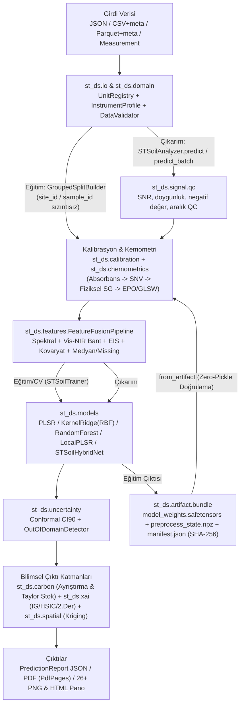

# STDS (SpaceTeknopoliDataScience) — Mevcut Proje Mimarisi ve Teknik Yapısı

> **Belge Kapsamı ve Doğrulama Politikası:** Bu doküman, `/Users/denizhan/Desktop/SpaceTeknopoliDataScience` çalışma dizinindeki mevcut kaynak kodlar, yapılandırma dosyaları, test dosyaları (`tests/`), vitrin çıktıları (`runs_examples/`) ve proje içi teknik belgeler incelenerek hazırlanmış ve 14 Kasım 2026 tarihli hata giderme/sertleştirme güncellemesi sonrasında yenilenmiştir. Canlı testler `/opt/anaconda3/bin/pytest tests/ -v` (**116/116 geçti**) ve `/opt/anaconda3/bin/python benchmarks/run_release_checks.py` ile doğrudan doğrulanmıştır; kaynak kodda bulunmayan hiçbir özellik var gibi gösterilmemiştir.

---

## 3.1. STDS Proje Genel Bakışı

### Projenin Tam Adı ve Kimliği
- **Proje Adı:** **SpaceTeknopoliDataScience (STDS)**
- **Python Paket Adı (`pyproject.toml`):** `st-ds` (import paketi: `st_ds`)
- **Mevcut Sürüm:** `0.1.0` (`st_ds.__version__`)
- **Şema ve Genel API Sürümleri:** `SCHEMA_VERSION = "1.0.0"`, `PUBLIC_API_VERSION = "1.0.0"`, `ARTIFACT_FORMAT_VERSION = "1.0.0"`

### Temel Amacı ve Çözmeyi Hedeflediği Problem
STDS (`st_ds`), donanım sürücülerinden ve web/veritabanı sunucularından tamamen izole edilmiş (**ADR-001**), tek başına çalışabilen bir **bilimsel toprak karbonu ve çok sensörlü spektral veri analizi kütüphanesi ve CLI motorudur**.

Projenin çözmeyi hedeflediği temel bilimsel ve mühendislik problemleri:
1. **Toprak Karbon Fraksiyonlarının Ayrıştırılması:** Toplam karbonu (`tc_pct`) tek başına organik karbon (`soc_pct`) gibi raporlama hatasını önlemek için **SOC** (Toprak Organik Karbonu), **SIC** (Toprak İnorganik Karbonu / karbonat) ve **TC** (Toplam Karbon) büyüklüklerini ayrı hedefler olarak tahmin etmek ve $TC = SOC + SIC$ fiziksel kapanış kuralını denetlemek (**ADR-004**).
2. **Nem ve Çevresel Girişimlerin Bastırılması:** Saha toprak spektrumlarında nemin (su bantları ~1415–1450 nm, ~1915–1945 nm) karbon sinyalini maskelemesini **EPO (External Parameter Orthogonalization)** ve **GLSW (Generalized Least Squares Weighting)** ile kalibrasyon–çıkarım uzay imzası kilidi altında bastırmak (**DEF-001 / ADR-003**).
3. **Cihaz Bağımsızlığı ve Birim Güvenliği:** Sabit 24 kanallı ve birimsiz dizi varsayımını kaldırarak her ölçümü açık `InstrumentProfile` (5 LED bandından 126 kanallı FT-NIR ve 84 kanallı LIBS'e kadar) ve `UnitRegistry` kanonik birim sistemiyle doğrulamak (**DEF-003 / DEF-004 / ADR-002**).
4. **Hacim Ağırlığı Olmadan Hatalı Stok Üretimini Önleme (Fail-Closed):** Eksik hacim ağırlığında (`bulk_density_g_cm3 is None`) sessizce `1.35 g/cm³` varsaymak yerine karbon stokunu hesaplamayı durdurmak (`stock_mg_ha = None`, `QualityFlag.MISSING_BULK_DENSITY`) ve mevcut olduğunda Taylor 1. derece belirsizlik yayılımıyla $\text{Mg C ha}^{-1}$ stokunu üretmek (**DEF-005**).
5. **Veri Sızıntısız Doğrulama, Kalibreli Belirsizlik ve OOD Güvenliği:** Aynı `site_id` / `sample_id` / `session_id` tekrarlarını eğitim ve doğrulama arasına sızdırmadan gruplu çapraz doğrulama (`GroupKFold` / `LeaveOneGroupOut`), Conformal Prediction (%90 tahmin aralığı) ve Mahalanobis + k-NN tabanlı Alan Dışı (OOD) risk denetimi uygulamak (**DEF-009**).
6. **Güvenli Model Paketleme (Zero-Pickle):** `.pkl` / güvensiz `torch.load` yerine `.safetensors` + `allow_pickle=False` `.npz` + SHA-256 doğrulamalı `manifest.json` paketlemesi sunmak (**DEF-006**).
7. **Genel / Toprak-Dışı Spektral Hedef Desteği:** `SoilReference.custom_targets` ve CLI `--target` / `--covariates` parametreleri aracılığıyla standart toprak karbon fraksiyonları dışındaki özel sayısal hedeflerde (örneğin örneklerde gösterilen gıda proteini veya PM2.5 gibi özel hedefler) stok ve geçici toprak taksonomisi adımlarını devre dışı bırakarak regresyon ve Conformal/XAI hattını çalıştırmak.

### Çalıştığı Veri Türleri ve Kapsadığı Alanlar
Kaynak koddan doğrudan doğrulanan alanlar ve veri türleri:
- **Toprak Bilimi ve Karbon Muhasebesi:** Vis-NIR/SWIR/FT-NIR yansıtma/absorbans/ham sayım spektrumları, LIBS spektrumları, toprak kimyasal/fiziksel eş değişkenleri (`ph`, `moisture_volumetric_pct`, `moisture_gravimetric_pct`, `temperature_c`, `ec_ds_m`, `bulk_density_g_cm3`, `coarse_fragments_fraction`), derinlik aralığı (`DepthInterval`), WGS-84 konum (`SpatialCoordinates`) ve laboratuvar karbon referansları (`soc_pct`, `sic_pct`, `tc_pct`).
- **Elektrokimyasal Empedans Spektroskopisi (EIS) ve DLIA:** Çok frekanslı empedans okumaları (`EISMeasurement`: `frequencies_hz`, `z_real_ohm`, `z_imag_ohm`) ve Faz Kilitli Amplifikatör (`DLIAReadout`: `i_component`, `q_component`) yardımcıları.
- **Veri Bilimi, Kemometri, Jeoistatistik ve XAI:** Sayısal sinyal işleme, kemometrik projeksiyon, çoklu model kıyaslama, Conformal belirsizlik kalibrasyonu, OOD tespiti, açıklanabilir yapay zekâ (IG, duyarlılık, HSIC, 2. derece etkileşim), 2D Ordinary Kriging jeoistatistiği, bilimsel görselleştirme (`matplotlib`, opsiyonel `plotly`) ve PDF/HTML raporlama.
- **Bilgisayarlı Görü (Computer Vision):** Kaynak kodda görüntü verisi işleme (CNN görüntü omurgası, OpenCV, görüntü okuyucular vb.) **bulunmamaktadır** (`st_ds/visualization/` yalnızca çıktı grafikleri için `matplotlib.image.imread` ile PDF içine PNG gömer).

### Gerçekleştirdiği Bilimsel Analizler, Matematiksel/İstatistiksel Yöntemler ve ML/DL Yetenekleri
- **Kalibrasyon & Sinyal QC:** Dark/White radyometrik düzeltme, kübik spline / doğrusal dalga boyu hizalama, ISS kalibrasyon transferi, ikinci fark MAD tabanlı SNR kestirimi, doygunluk/negatiflik/kapsam kontrolleri, LIBS atış (shot) filtreleme, arPLS taban çizgisi düzeltmesi, Pseudo-Voigt tepe eğrisi uydurma.
- **Kemometri:** Absorbans (`-log10(R)`), SNV, fiziksel $\Delta\lambda$ (nm) ölçekli üniform ve düzensiz grid Savitzky–Golay türevleri, SVD tabanlı EPO ve regülarize GLSW nem bastırma.
- **Özellik Çıkarımı & Füzyon:** Dalga boyu aralık sorgulu Vis-NIR kimyasal bant özetleri, EIS türetilmiş öznitelikler, sıcaklığa düzeltilmiş $EC_{25}$, medyan atamalı ve eksik bayraklı dal bazlı ölçekleme.
- **Makine Öğrenmesi & Derin Öğrenme:**
  - Klasik kemometrik/istatistiksel modeller: `PLSRRegressor` (`PLSRegression`), `KernelRidgeRegressor` (özel RBF + Cholesky), `RandomForestSoilRegressor`, `LocalPLSRRegressor` (MBL/Gaussian-ağırlıklı yerel PLSR).
  - Derin öğrenme (PyTorch): İki dallı artık yoğun bloklu (`_ResidualDenseBlock`) çok görevli sinir ağı `STSoilHybridNet` (`STSoilHybridNetRegressor`), heteroskedastik Gauss NLL + Huber + TC kapanış cezası (`STSoilMultiTaskLoss`) ve isteğe bağlı MC-Dropout belirsizliği.
- **Belirsizlik, XAI, Stok ve Jeoistatistik:** Split Conformal Prediction (`ConformalUncertaintyCalibrator`), shrinkage Mahalanobis + k-NN `OutOfDomainDetector`, `GroupedBootstrapEnsemble`, Gauss-Legendre Integrated Gradients, ölçek-normalize yerel duyarlılık, merkezlenmiş RBF-HSIC ($n < 4$ fail-closed), 2. derece karma kısmi türev etkileşimi, Taylor 1. derece karbon stoku belirsizliği, Matheron deneysel variogramı + doğrusal olmayan en küçük kareler + 2D `ordinary_kriging` ve GeoJSON dışa aktarımı.

### C++ ve Python Kullanımı
Projede **C++ veya CMake katmanı yoktur** (kök ve alt dizinlerde `.c`, `.cpp`, `.cc`, `.cxx`, `.h`, `.hpp`, `CMakeLists.txt` veya `.cmake` dosyası bulunmamaktadır). Sistem baştan sona saf **Python (>=3.11)** ile yazılmıştır; yoğun doğrusal cebir, optimizasyon, SVD, Cholesky ve sinir ağı hesaplamaları alttaki NumPy, SciPy, scikit-learn ve PyTorch kütüphanelerinin derlenmiş çekirdekleri üzerinden yürütülür.

### Genel Çalışma Mantığı
STDS iki ana yaşam döngüsü etrafında çalışır:
1. **Eğitim / Kıyaslama Hattı:** Ham `SoilDataset` (JSON/CSV/Parquet) -> `DataValidator` şema/birim doğrulaması -> `GroupedSplitBuilder` (`site_id`/`sample_id` sızıntısız katmanlar) -> kat içi `ChemometricPipeline` (Absorbans + SNV + SG + EPO/GLSW) -> `FeatureFusionPipeline` -> aday modeller üzerinde OOF kıyaslama (`STSoilTrainer.run_benchmark`) -> en iyi veya seçilen modelin tam veri üzerinde eğitimi -> OOF Conformal + OOD kalibrasyonu -> `.safetensors` + `preprocess_state.npz` + `model_card.json` + SHA-256 `manifest.json` olarak paketleme (`save_artifact`).
2. **Çıkarım / Analiz Hattı:** `STSoilAnalyzer.from_artifact(...)` ile SHA-256 bütünlük doğrulaması ve zero-pickle yükleme -> tekil `predict(Measurement)` veya kısmi hata yalıtımlı `predict_batch(...)` -> 7 aşamalı çıkarım boru hattı (doğrulama/QC -> kemometri+füzyon -> model çıkarımı -> Conformal CI90 + OOD -> karbon ayrıştırma ve fail-closed Taylor stok -> geçici taksonomi -> isteğe bağlı XAI) -> `PredictionReport` JSON / çok sayfalı PDF / 26+ görselli HTML pano.

### Mevcut Geliştirme ve Çalışma Durumu
- **Kod ve Paket Durumu:** `v0.1.0` MVP kodu tüm 11 geliştirme fazı ve 14 Kasım 2026 tarihli hata giderme/regresyon sertleştirmesi boyunca (`st_ds/` kaynak modülleri, **17 test dosyası**, 3 bash boru hattı, 6 örnek/benchmark dosyası) tamamlanmıştır (`docs/RELEASE_NOTES.md`).
- **Önceden Üretilmiş Çıktılar:** `runs_examples/` altında **TR** (`20261114_005026_full_run`) ve **EN** (`20261114_005111_full_run`) tam vitrin çalıştırmaları, `runs/` altında 4 adet zaman damgalı yerel çalıştırma klasörü mevcuttur.
- **Canlı Çalışma ve Sürüm Doğrulaması (14 Kasım 2026):** `/opt/anaconda3/bin/pytest tests/ -v` (**116/116 geçti**), `/opt/anaconda3/bin/python benchmarks/run_release_checks.py` (deterministik tekrar oynatma `max_prediction_diff=0.0`, holdout `R²=0.9385`) ve `STDS_LANG=tr` / `STDS_LANG=en` `scripts/03_run_full_pipeline.sh` uçtan uca koşuları başarıyla doğrulanmıştır.

---

## 3.2. Tam Dosya ve Klasör Dizin Yapısı

### Gerçek Dizin Ağacı

```text
SpaceTeknopoliDataScience/
├── .env                          # Yerel çalışma ortamı ayarları (takip edilir; değerleri dokümana yazılmamıştır)
├── .env.example                  # Örnek ortam değişkeni şablonu (STDS_LANG, STDS_RUNS_DIR, vb.)
├── .gitignore                    # runs/, dist/, artifacts/, cache hariç tutma ve .env/runs_examples istisnaları
├── .pytest_cache/                # [OTOMATİK CACHE] Önceki pytest koşularından kalan önbellek dizini
├── pyproject.toml                # Paket metadata, Python >=3.11 gereksinimi, bağımlılıklar ve `st-ds` CLI entrypoint
├── README.md                     # Proje genel bakışı, mimari özet, hızlı başlangıç ve CLI kılavuzu
├── STDS_Tam_Sistem_Mimarisi_ve_Fazli_Gelistirme_Plani.pdf  # Kaynak mimari spesifikasyon PDF'i
├── benchmarks/
│   └── run_release_checks.py     # Faz 11 holdout, deterministik replay, profilleme ve model card doğrulama betiği
├── docs/
│   ├── ACADEMIC_METHODOLOGY_AND_ALGORITHMS.md
│   ├── CLI_AND_PYTHON_PARAMETERS_GUIDE.md
│   ├── DATA_PREPARATION_AND_SCHEMA_GUIDE.md
│   ├── FIRST_TIME_ROADMAP_GUIDE.md
│   ├── GENERAL_DATA_ANALYSIS_GUIDE.md
│   ├── MODEL_CARD_TEMPLATE.md
│   ├── RELEASE_NOTES.md
│   ├── SYNTHETIC_TESTING_GUIDE.md
│   ├── SYSTEM_AND_USAGE_GUIDE.md
│   ├── TOPRAK_ANALIZ.md
│   ├── assets/                   # Dokümantasyon görselleri (01_..06_*.png — 6 adet statik PNG)
│   └── faz0/
│       ├── STDS_ARCHITECTURE_DECISIONS.md  # ADR-001..007 ve OD-001..006 karar kayıtları
│       ├── architecture_audit_report.md    # Faz 0 denetim raporu
│       └── known_defects.md                # DEF-001..009 kusur ve çözüm sözleşmeleri
├── examples/
│   ├── 01_all_cli_commands_and_params.sh   # 8 CLI alt komutunun parametreli örnek betiği
│   ├── 02_all_python_api_parameters.py     # Tüm Python API sınıfları/parametreleri vitrini
│   ├── 03_custom_csv_and_non_soil_domains.py  # Ham CSV ve toprak-dışı özel hedef örneği
│   ├── README.md                           # Örnekler dizini kılavuzu
│   ├── cli_workflow.sh                     # 8 adımlı temel CLI iş akışı
│   └── synthetic_python_quickstart.py      # Hızlı uçtan uca sentetik Python API başlangıcı
├── runs/                         # [ÇIKTI / .gitignore] Zaman damgalı yerel çalıştırma çıktıları (4 adet klasör)
│   ├── 20261113_024023_synthetic_data/
│   ├── 20261113_024031_train_eval/
│   ├── 20261113_024056_full_run/
│   └── 20261113_032839_full_run/
├── runs_examples/                # Repoda saklanan 2 adet güncel TR/EN tam boru hattı vitrin çıktısı
│   ├── README.md
│   ├── 20261114_005026_full_run/ # Türkçe tam çalıştırma (TARGET=soc_pct, MODEL=auto, aktif EPO, 26 PNG, 5 tablo, HTML, 28 sf. PDF)
│   └── 20261114_005111_full_run/ # İngilizce tam çalıştırma (aynı boru hattının EN yerelleştirmeli çıktısı)
├── scripts/
│   ├── 01_generate_synthetic_data.sh  # Sentetik veri + wet/dry EPO çifti üretimi
│   ├── 02_train_and_evaluate.sh       # Doğrulama + fit-epo + CV kıyaslama + eğitim + PDF özet
│   └── 03_run_full_pipeline.sh        # 6 aşamalı uçtan uca üretim/demo boru hattı
├── st_ds/                        # Ana Python kütüphanesi kaynak kodu
│   ├── __init__.py               # Paket genel API dışa aktarımı (`__version__`, `SCHEMA_VERSION`, facade & helper'lar)
│   ├── config.py                 # `.env` çözümleyici ve çalışma zamanı yapılandırması (`STDSRuntimeConfig`)
│   ├── i18n.py                   # TR/EN yerelleştirme sözlüğü (`MESSAGES`, `t`, `pick_text`)
│   ├── api/
│   │   ├── __init__.py
│   │   ├── analyzer.py           # Ana çıkarım/XAI/stok/OOD facade sınıfı (`STSoilAnalyzer`)
│   │   └── versioning.py         # `PUBLIC_API_VERSION`, `SUPPORTED_REPORT_SCHEMA_VERSION`
│   ├── artifact/
│   │   ├── __init__.py
│   │   └── bundle.py             # Zero-pickle `.safetensors` + `.npz` + SHA-256 `manifest.json` paketleme/yükleme
│   ├── calibration/
│   │   ├── __init__.py
│   │   ├── iss.py                # Internal Soil Standard (`fit_iss`, `apply_iss`)
│   │   ├── radiometry.py         # Dark/White yansıtma kalibrasyonu (`calibrate_reflectance`)
│   │   └── wavelength.py         # Dalga boyu grid hizalama (`align_wavelengths`)
│   ├── carbon/
│   │   ├── __init__.py
│   │   ├── fractions.py          # SOC/SIC/TC ayrıştırma (`partition_carbon`) ve geçici toprak sınıflandırma
│   │   └── stock.py              # Katman/profil karbon stoku ve 1. derece Taylor belirsizliği
│   ├── chemometrics/
│   │   ├── __init__.py
│   │   ├── epo.py                # `EPO` ve `GLSW` nem bastırma projeksiyonları
│   │   ├── pipeline.py           # Uzay imzası kilitli `ChemometricPipeline` ve `PreprocessConfig`
│   │   ├── savgol.py             # Fiziksel $\Delta\lambda$ (nm) ve düzensiz grid Savitzky-Golay türevi
│   │   └── transforms.py         # `validate_spectral_grid`, `to_absorbance`, `snv_transform`
│   ├── cli/
│   │   ├── __init__.py
│   │   ├── __main__.py           # `python -m st_ds.cli` giriş noktası
│   │   └── main.py               # `st-ds` CLI ayrıştırıcısı ve 8 alt komut işleyicisi
│   ├── domain/
│   │   ├── __init__.py
│   │   ├── errors.py             # `STDSError` ve 8 özelleşmiş hata sınıfı
│   │   ├── instrument.py         # `InstrumentProfile`, 5 yerleşik sensör profili, profil çözümleyici
│   │   ├── protocols.py          # `RegressorProtocol`, `CalibratorProtocol`, `SignalQCProtocol`, `AnalyzerProtocol`
│   │   ├── quality.py            # `QualityStatus`, `QualityFlag`, `QualityMetadata`
│   │   ├── schemas.py            # Kanonik veri sınıfları (`Measurement`, `Spectrum`, `PredictionReport`, vb.)
│   │   └── units.py              # `UnitRegistry` ve 13 fiziksel büyüklük aralığı/dönüşümü
│   ├── features/
│   │   ├── __init__.py
│   │   ├── extractors.py         # Vis-NIR kimyasal bant, EIS ve türev ($EC_{25}$) çıkarıcıları
│   │   ├── fusion.py             # Dal bazlı ölçekleme, medyan atama ve `FeatureFusionPipeline`
│   │   └── registry.py           # İsimli `FeatureRegistry` ve `FeatureProfileSpec` SHA-256 şeması
│   ├── io/
│   │   ├── __init__.py
│   │   ├── dataset.py            # `SoilDataset`, JSON/CSV/Parquet (+`.meta.json`) G/Ç ve kalite/kimlik kartları
│   │   ├── reference_store.py    # `ReferenceLabelStore` (CSV/JSON referans laboratuvar eşleştirici)
│   │   ├── synthetic.py          # `SyntheticGeneratorV2` (Beer-Lambert + wet/dry + tekrar ölçümler)
│   │   └── validator.py          # `DataValidator` toplu veri kümesi doğrulayıcı
│   ├── models/
│   │   ├── __init__.py
│   │   ├── base.py               # `BaseSoilRegressor`, `ModelPrediction`, negatif/kapanış yardımcıları
│   │   ├── baselines.py          # `PLSRRegressor`, `KernelRidgeRegressor`, `RandomForestSoilRegressor`, `LocalPLSRRegressor`
│   │   ├── hybrid_net.py         # PyTorch `STSoilHybridNet` ve `STSoilHybridNetRegressor`
│   │   └── loss.py               # `STSoilMultiTaskLoss` ve `gaussian_nll_loss`
│   ├── reporting/
│   │   ├── __init__.py
│   │   └── pdf_report.py         # `PdfPages` tabanlı çok sayfalı bilimsel PDF rapor motoru
│   ├── signal/
│   │   ├── __init__.py
│   │   ├── baseline.py           # `estimate_arpls_baseline`, `correct_baseline`
│   │   ├── dlia.py               # `DLIAReadout`, `summarize_dlia_outputs`
│   │   ├── libs_qc.py            # `filter_libs_shots`, `LIBSShotQCConfig`
│   │   ├── peaks.py              # `fit_pseudovoigt_peaks`, `extract_libs_peak_features`
│   │   └── qc.py                 # `estimate_spectral_snr`, `evaluate_signal_qc`
│   ├── spatial/
│   │   ├── __init__.py
│   │   ├── kriging.py            # 2D `ordinary_kriging`, dış değerleme maskesi, `kriging_to_geojson`
│   │   └── variogram.py          # `SpatialCoordinateFrame` (teğet düzlem), Matheron variogramı, `fit_variogram`
│   ├── training/
│   │   ├── __init__.py
│   │   ├── metrics.py            # MAE, RMSE, Bias, R², RPIQ, Bland-Altman, alt-grup & kapanış metrikleri
│   │   ├── splits.py             # `GroupedSplitBuilder` (GroupKFold, LeaveOneGroupOut, sızıntı doğrulama)
│   │   └── trainer.py            # `STSoilTrainer` (sızıntısız kat içi fit + çoklu model OOF kıyaslama)
│   ├── uncertainty/
│   │   ├── __init__.py
│   │   ├── conformal.py          # `ConformalUncertaintyCalibrator`, kalibrasyon eğrisi, kapsam raporu
│   │   ├── ensemble.py           # `estimate_ensemble_spread`, `GroupedBootstrapEnsemble`
│   │   └── ood.py                # `OutOfDomainDetector` (shrinkage Mahalanobis + k-NN + zarf)
│   ├── validation/
│   │   ├── __init__.py
│   │   ├── model_card.py         # Markdown `model_card` üretici ve bölüm doğrulayıcı
│   │   └── release_checks.py     # Bilimsel holdout, deterministik tekrar oynatma ve hız/bellek profilleme
│   ├── visualization/
│   │   ├── __init__.py
│   │   ├── base.py               # `VisualizationConfig`, `DatasetArrays`, `save_figure`, renk paleti
│   │   ├── model_plots.py        # Grafikler 08–16 (kıyaslama, parity+CI90, Bland-Altman, OOD, 3D PCA)
│   │   ├── science_plots.py      # Grafikler 17–23 (XAI IG/HSIC/etkileşim, fraksiyon, stok tornado, variogram, Kriging)
│   │   ├── spectral_plots.py     # Grafikler 01–07 (ham spektrum, kemometri, EPO, 3D yüzey, korelasyon, QC, EIS/kovaryat)
│   │   ├── suite.py              # `generate_full_visualization_suite` ana orkestratörü
│   │   └── tables_and_dashboard.py # 5 CSV/MD tablo, Grafik 24–26, Plotly 3D HTML ve çevrimdışı `index.html`
│   └── xai/
│       ├── __init__.py
│       ├── engine.py             # `SoilXAIEngine`, `XAIExplanationReport`, `ComponentRanking`
│       ├── hsic.py               # Merkezlenmiş RBF-HSIC (n < 4 fail-closed)
│       ├── interactions.py       # 2. derece çapraz kısmi türev / 2D pertürbasyon etkileşimi
│       └── sensitivity.py        # Ölçek-normalize yerel duyarlılık ve Gauss-Legendre Integrated Gradients
└── tests/
    ├── contract/
    │   └── test_artifact_security.py
    ├── integration/
    │   ├── test_custom_target_and_cli_flexibility.py
    │   ├── test_end_to_end_pipeline.py
    │   ├── test_i18n_pdf_and_scripts.py
    │   ├── test_release_readiness.py
    │   └── test_visualization_suite.py
    └── unit/
        ├── test_bugfix_regressions.py
        ├── test_faz10_api_and_cli.py
        ├── test_faz1_domain_and_units.py
        ├── test_faz2_dataset_splits_synthetic.py
        ├── test_faz3_calibration_and_signal_qc.py
        ├── test_faz4_chemometrics_and_epo.py
        ├── test_faz5_feature_fusion.py
        ├── test_faz6_models_and_trainer.py
        ├── test_faz7_uncertainty_and_ood.py
        ├── test_faz8_xai.py
        └── test_faz9_carbon_and_spatial.py
```

### Hariç Tutulan / Gruplandırılan Klasörler ve Nedenleri
- **`.git/`**: Sürüm kontrol tarihçesi ve nesne deposu; kaynak mimari bileşeni olmadığı için ağaçtan hariç tutulmuştur.
- **`__pycache__/` ve `.pytest_cache/`**: Python derlenmiş bayt kodu ve `pytest` önbellek dizinleri (otomatik üretilen çıktılar) okunabilirlik için tek tek listelenmemiştir.
- **`runs/` alt içeriği (`20261113_024023_*` vb.) ve `runs_examples/*_full_run/05_visualization_suite/{plots,tables,interactive,reports}`**: Çalışma zamanında üretilen 26 PNG, 5 CSV/MD tablo, 3 Plotly HTML, PDF raporları ve model artefaktları çok uzun olduğundan alt dizin başlıklarıyla gruplandırılmıştır.

### Önemli Dosya ve Klasörler Tablosu

| Dosya / Klasör | Görevi | İlgili Modül | Bağımlılıkları | Durum |
|---|---|---|---|---|
| `pyproject.toml` | Paket tanımı, bağımlılık kısıtları ve `st-ds` konsol betiği giriş noktası | Paketleme | `setuptools>=68.0`, `wheel` | Mevcut (Doğrulandı) |
| `st_ds/__init__.py` | Kütüphane genel API dışa aktarımları ve sürüm sabitleri | Ana Paket | `st_ds.api`, `st_ds.artifact`, `st_ds.config`, `st_ds.reporting`, `st_ds.visualization` | Mevcut (Doğrulandı) |
| `st_ds/config.py` | `.env` ayrıştırma ve `STDS_LANG`, `STDS_DPI`, `STDS_RUNS_DIR` çözümü | Yapılandırma | Python stdlib (`os`, `pathlib`, `dataclasses`) | Mevcut |
| `st_ds/cli/main.py` | **Kritik Giriş Noktası:** 8 alt komutlu `st-ds` CLI (`dataset`, `calibration`, `train`, `evaluate`, `artifact`, `predict`, `report`, `visualize`) | `st_ds.cli` | `st_ds.api`, `st_ds.training`, `st_ds.artifact`, `st_ds.visualization`, `st_ds.reporting` | Mevcut |
| `st_ds/api/analyzer.py` | **Kritik Giriş Noktası:** `STSoilAnalyzer` facade (`from_artifact`, `predict`, `predict_batch`, `explain`) | `st_ds.api` | `artifact`, `domain`, `signal`, `chemometrics`, `features`, `models`, `uncertainty`, `carbon`, `xai` | Mevcut |
| `st_ds/domain/schemas.py` & `units.py` & `instrument.py` | Kanonik veri sözleşmeleri (`Measurement`, `PredictionReport`), `UnitRegistry`, 5 `InstrumentProfile` | `st_ds.domain` | `numpy`, `dataclasses` | Mevcut |
| `st_ds/io/dataset.py` & `synthetic.py` | `SoilDataset`, JSON/CSV/Parquet G/Ç, `DataValidator`, `SyntheticGeneratorV2` | `st_ds.io` | `numpy`, `pandas`, (`pyarrow` Parquet için), `st_ds.domain` | Mevcut (Excel yok) |
| `st_ds/chemometrics/pipeline.py` & `epo.py` & `savgol.py` | Absorbans, SNV, fiziksel Savitzky-Golay ve SHA-256 uzay kilitli EPO/GLSW | `st_ds.chemometrics` | `numpy`, `scipy.signal`, `st_ds.domain` | Mevcut |
| `st_ds/features/fusion.py` & `registry.py` | İsimli özellik şeması, dal bazlı ölçekleme, medyan atama ve EIS/$EC_{25}$/Vis-NIR füzyonu | `st_ds.features` | `numpy`, `st_ds.chemometrics`, `st_ds.domain` | Mevcut |
| `st_ds/models/baselines.py` & `hybrid_net.py` & `loss.py` | 4 klasik model + PyTorch `STSoilHybridNetRegressor` + çok görevli kayıp | `st_ds.models` | `numpy`, `scipy.linalg`, `scikit-learn`, `torch` | Mevcut |
| `st_ds/training/trainer.py` & `splits.py` | Sızıntısız `GroupKFold`/`LeaveOneGroupOut` ve kat içi çoklu model OOF kıyaslaması | `st_ds.training` | `numpy`, `scikit-learn`, `st_ds.models`, `st_ds.chemometrics`, `st_ds.features` | Mevcut |
| `st_ds/uncertainty/conformal.py` & `ood.py` | Split Conformal CI90, kalibrasyon eğrisi ve Mahalanobis + k-NN `OutOfDomainDetector` | `st_ds.uncertainty` | `numpy`, `scipy.linalg`, `st_ds.domain` | Mevcut |
| `st_ds/xai/engine.py` & alt modüller | Duyarlılık, Gauss-Legendre IG, RBF-HSIC ($n\ge 4$), 2. derece etkileşim | `st_ds.xai` | `numpy`, `torch` (opsiyonel autograd), `st_ds.models` | Mevcut |
| `st_ds/carbon/fractions.py` & `stock.py` | SOC/SIC/TC ayrıştırma, geçici taksonomi, Taylor 1. derece karbon stoku | `st_ds.carbon` | `numpy`, `st_ds.domain`, `st_ds.models.base` | Mevcut |
| `st_ds/spatial/variogram.py` & `kriging.py` | Teğet düzlem koordinatları, Matheron variogramı, 2D Ordinary Kriging, GeoJSON | `st_ds.spatial` | `numpy`, `scipy.optimize`, `scipy.spatial.Delaunay` | Mevcut |
| `st_ds/artifact/bundle.py` | **Kritik Güvenlik Sınırı:** `.safetensors` + `.npz` + SHA-256 `manifest.json` kaydetme/doğrulama/yükleme | `st_ds.artifact` | `numpy`, `torch`, `safetensors`, `st_ds.*` | Mevcut |
| `st_ds/visualization/suite.py` & `reporting/pdf_report.py` | 26 PNG/SVG, 5 CSV/MD tablo, Plotly 3D HTML, `index.html` pano ve çok sayfalı PDF motoru | `st_ds.visualization`, `st_ds.reporting` | `matplotlib`, `numpy`, `plotly` (opsiyonel), `st_ds.spatial` | Mevcut |
| `st_ds/validation/release_checks.py` & `benchmarks/run_release_checks.py` | Holdout bilimsel kontrol, deterministik replay, hız/bellek profilleme | `st_ds.validation` | `tracemalloc`, `time`, `st_ds.*` | Mevcut |
| `scripts/01..03_*.sh` | Otomatik bash boru hatları (veri üretimi, eğitim/değerlendirme, tam analiz) | Dış Betikler | `/opt/anaconda3/bin/python` veya `python3`, `st_ds.cli` | Mevcut |
| `tests/` (17 test dosyası) | Unit (Faz 1–10 + `test_bugfix_regressions.py`), Contract (`test_artifact_security.py`) ve Integration (5 dosya) testleri | Test Paketi | `pytest`, `pandas`, `st_ds` | Mevcut (`116 passed` doğrulandı) |

---

## 3.3. Kullanılan Teknolojiler ve Bağımlılıklar

### Dil ve Derleme / Paketleme Altyapısı İncelemesi
- **C++ Standardı / C++ Kütüphaneleri / CMake:** Projede **hiçbir C/C++ kaynak kodu (`.c`, `.cpp`, `.h`, `.hpp`) veya CMake dosyası (`CMakeLists.txt`, `*.cmake`) yoktur.**
- **Python Sürümü (`pyproject.toml`):** `requires-python = ">=3.11"`. Depoda yer alan önceden üretilmiş artefakt manifestosunda (`runs_examples/20261114_005026_full_run/03_artifact_bundle/manifest.json`) ve canlı ortam doğrulamasında (`benchmarks/run_release_checks.py`) kaydedilen çalışma zamanı Python sürümü **`3.13.9`**'dur.
- **Paketleme ve Build Sistemi:** `pyproject.toml` üzerinden **PEP 517/518** uyumlu `setuptools>=68.0` + `wheel` (`build-backend = "setuptools.build_meta"`). Konsol betiği: `st-ds = "st_ds.cli.main:main"`.

### Teknoloji ve Bağımlılık Envanteri

| Teknoloji | Sürüm | Kullanım Amacı | İlgili Dosyalar | Durum |
|---|---|---|---|---|
| **Python** | `>=3.11` (`manifest.json`: `3.13.9`) | Tüm STDS çekirdek kütüphanesi ve CLI dili | `pyproject.toml`, tüm `st_ds/*.py` | Doğrulandı (`manifest.json` & `pyproject.toml`) |
| **NumPy** | `>=1.26.0,<3.0` (`manifest.json`: `2.2.6`) | Dizi/matris işlemleri, SVD (`EPO`, `PCA`), Cholesky/lineer cebir, Vandermonde SG | Tüm sayısal modüller (`chemometrics`, `features`, `models`, `uncertainty`, `spatial`, `xai`, `carbon`) | Aktif Kullanımda |
| **SciPy** | `>=1.11.0,<2.0` (`manifest.json`: `1.17.0`) | `CubicSpline` (`wavelength`), `spsolve` (`arPLS`), `curve_fit` (`Pseudo-Voigt`), `savgol_filter`, `cho_factor`/`cho_solve` (`KernelRidge`, `OOD`), `least_squares` (`variogram`), `Delaunay` (`kriging`) | `calibration/`, `signal/`, `chemometrics/`, `models/`, `uncertainty/`, `spatial/` | Aktif Kullanımda |
| **PyTorch (`torch`)** | `>=2.2.0,<3.0` (`manifest.json`: `2.7.1`) | `STSoilHybridNet` derin ağı, `AdamW`, `STSoilMultiTaskLoss`, autograd 1./2. derece XAI türevleri | `st_ds/models/hybrid_net.py`, `loss.py`, `xai/sensitivity.py`, `xai/interactions.py`, `artifact/bundle.py` | Aktif Kullanımda |
| **Scikit-learn** | `>=1.4.0,<2.0` (`manifest.json`: `1.6.1`) | `PLSRegression` (`PLSRRegressor`, `LocalPLSRRegressor`), `RandomForestRegressor`, `GroupKFold`, `LeaveOneGroupOut` | `st_ds/models/baselines.py`, `st_ds/training/splits.py` | Aktif Kullanımda |
| **Safetensors** | `>=0.5.3,<1.0` (`manifest.json`: `0.5.3`) | Sıfır-pickle model ağırlığı ve donmuş ağaç/PLS tensör serileştirmesi (`safetensors.torch`, `safetensors.numpy`) | `st_ds/artifact/bundle.py` | Aktif Kullanımda |
| **Pandas** | `>=2.1.0,<3.0` (`run_release_checks`: `2.2.3`) | CSV ve Parquet veri setlerinin ve `ReferenceLabelStore` tablolarının DataFrame okuma/yazması | `st_ds/io/dataset.py`, `st_ds/io/reference_store.py` | Aktif Kullanımda |
| **Matplotlib** | `>=3.8.0,<4.0` | Headless (`Agg`) 26+ 2D/3D bilimsel grafik (PNG/SVG) ve `PdfPages` çok sayfalı PDF rapor üretimi | `st_ds/visualization/*`, `st_ds/reporting/pdf_report.py` | Aktif Kullanımda |
| **Pydantic** | `>=2.5.0,<3.0` (`run_release_checks`: `2.13.5`) | `pyproject.toml` içinde zorunlu bağımlılık olarak tanımlı; `validation/release_checks.py` sürüm sorgusu dışında **`st_ds/` kodunda import edilmemektedir** (şemalar stdlib `@dataclass` ile kuruludur) | `pyproject.toml`, `st_ds/validation/release_checks.py` | Bildirilmiş ama kodda kullanılmıyor |
| **Plotly (`[viz]` extra)** | `>=5.20.0,<6.0` | İsteğe bağlı etkileşimli 3D HTML grafikleri (`plotly.graph_objects`, `ImportError` durumunda atlanır) | `st_ds/visualization/tables_and_dashboard.py` | Opsiyonel Kullanımda |
| **Seaborn (`[viz]` extra)** | `>=0.13.0,<1.0` | `pyproject.toml` `[viz]` altında listelenmiş ancak **`st_ds/` kaynak kodunda import edilmemektedir** | `pyproject.toml` | Bildirilmiş ama kodda kullanılmıyor |
| **PyArrow** | Tanımlı değil (`pyproject.toml`'da yok) | `save_dataset_parquet` / `load_dataset_parquet` tarafından `pd.DataFrame.to_parquet` / `read_parquet` için gereklidir | `st_ds/io/dataset.py` | Koşullu / Harici Bağımlılık |
| **Pytest (`[dev]` extra)** | `>=8.3.0,<9.0` (doğrulanan: `8.3.4`) | Birim, sözleşme ve entegrasyon test koşucusu | `pyproject.toml`, `tests/` | Aktif (`116 passed` doğrulandı) |
| **OpenCV / TensorFlow** | Yok | Kullanılmıyor | — | Projede Yok |

---

## 3.4. STDS Genel Yazılım Mimarisi

STDS katmanlı, tek yönlü bağımlılığa yakın modüler bir Python kütüphanesi olarak tasarlanmıştır:

1. **Yapılandırma ve Yerelleştirme Katmanı (`config.py`, `i18n.py`):** İsteğe bağlı `.env` dosyasını (`explicit > os.environ > .env > varsayılan`) okuyarak dil (`tr`/`en`), çıktı klasörü (`STDS_RUNS_DIR`), DPI (`STDS_DPI`), PDF dışa aktarım (`STDS_PDF_EXPORT`) ve profil ayarlarını çözümler.
2. **Alan Sözleşmesi ve Fiziksel Bütünlük Katmanı (`st_ds/domain/`):** Tüm sistemin ortak dili olan `Measurement`, `Spectrum`, `CovariateSet`, `SoilReference`, `PredictionReport`, `InstrumentProfile`, `UnitRegistry` (`to_canonical`, `validate_physical_range`), `QualityStatus`/`QualityFlag` ve `STDSError` hata hiyerarşisini tanımlar.
3. **Veri Giriş/Çıkış ve Sentetik Üretim Katmanı (`st_ds/io/`):** `SoilDataset` (gerçek `real_lab` vs `synthetic` veri izolasyonu ve SHA-256 içerik özeti), JSON/CSV/Parquet + `.meta.json` yan dosyaları, `DataValidator`, `ReferenceLabelStore` ve Beer-Lambert tabanlı `SyntheticGeneratorV2` içerir.
4. **Sinyal İşleme, Kalibrasyon ve Kemometri Katmanı (`st_ds/calibration/`, `st_ds/signal/`, `st_ds/chemometrics/`):** Radyometrik düzeltme (`calibrate_reflectance`), dalga boyu hizalama (`align_wavelengths`), ISS (`fit_iss`/`apply_iss`), sinyal QC (`evaluate_signal_qc`), arPLS/Pseudo-Voigt/DLIA yardımcıları ve uzay imzası (`space_signature`) kilitli kemometrik boru hattı (`ChemometricPipeline`: Absorbans, SNV, fiziksel Savitzky–Golay, EPO/GLSW).
5. **Özellik Kaydı ve Çoklu Sensör Füzyonu Katmanı (`st_ds/features/`):** `FeatureRegistry` ile spektral kanalları, Vis-NIR kimyasal bantlarını, EIS özelliklerini, ham kovaryatları, türetilmiş $EC_{25}$ değerini ve eksik gösterge bayraklarını (`is_missing_*`) SHA-256 `schema_hash` ile adlandırıp dal bazlı ölçekler (`FeatureFusionPipeline`).
6. **Modelleme ve Sızıntısız Eğitim Katmanı (`st_ds/models/`, `st_ds/training/`):** `BaseSoilRegressor` sözleşmesini uygulayan 4 klasik model (`PLSRRegressor`, `KernelRidgeRegressor`, `RandomForestSoilRegressor`, `LocalPLSRRegressor`) ve PyTorch tabanlı `STSoilHybridNetRegressor` (`STSoilMultiTaskLoss`) ile grup bazlı katlama (`GroupedSplitBuilder`) ve kat içi kıyaslama motoru (`STSoilTrainer`).
7. **Belirsizlik, XAI, Karbon ve Jeoistatistik Katmanı (`st_ds/uncertainty/`, `st_ds/xai/`, `st_ds/carbon/`, `st_ds/spatial/`):** Split Conformal CI90, shrinkage Mahalanobis + k-NN `OutOfDomainDetector`, `GroupedBootstrapEnsemble`, `SoilXAIEngine`, SOC/SIC/TC ayrıştırma, fail-closed Taylor karbon stoku ve 2D variogram + `ordinary_kriging`.
8. **Güvenli Artefakt Yönetimi (`st_ds/artifact/`):** Tüm eğitilmiş model ağırlıklarını (`.safetensors`), ön işleme/EPO/ölçekleyici/Conformal/OOD/XAI arka plan durumlarını (`preprocess_state.npz`, `allow_pickle=False`), model kartını (`model_card.json`) ve dosya özetlerini (`manifest.json` + `bundle_sha256`) sıfır-pickle kuralıyla yönetir.
9. **Uygulama Arayüzü, CLI, Raporlama ve Görselleştirme Katmanı (`st_ds/api/`, `st_ds/cli/`, `st_ds/visualization/`, `st_ds/reporting/`, `st_ds/validation/`):** Dış tüketiciler için `STSoilAnalyzer` Python API'si ve 8 alt komutlu `st-ds` CLI'sini; çıktı olarak da JSON, 26+ PNG/SVG grafik, 5 CSV/MD tablo, çevrimdışı HTML pano, isteğe bağlı Plotly 3D HTML ve çok sayfalı PDF raporlarını sunar.

### Mimari Veri Akışı Diyagramı



---

## 3.5. Core ve Modül Mimarisi

Aşağıda `st_ds` altındaki her ana modül kaynak koddan doğrulanmış sınıf, fonksiyon, bağımlılık ve G/Ç detaylarıyla incelenmiştir.

### 1. `st_ds.config` ve `st_ds.i18n`
1. **Modül Adı:** `st_ds/config.py`, `st_ds/i18n.py`
2. **Amacı:** Harici `.env` bağımlılıklarını zorunlu kılmadan çalışma zamanı ayarlarını ve `tr`/`en` yerelleştirmesini yönetmek.
3. **Sorumlulukları:** Öncelik sırasıyla (`explicit arg > os.environ > .env > varsayılan`) dil, çıktı klasörü, DPI, PDF bayrağı ve varsayılan profil ID'sini çözmek; plot/HTML/PDF/CLI metinlerini çevirmek.
4. **Sınıflar:** `STDSRuntimeConfig` (`lang`, `runs_dir`, `dpi`, `pdf_export`, `default_instrument_profile`, `env_file_path`).
5. **Fonksiyonlar:** `normalize_lang`, `load_dotenv_dict`, `resolve_lang`, `get_runtime_config`, `pick_text`, `t`.
6. **Matematiksel Yöntemler:** Yok (yalnızca dize ayrıştırma ve sayısal DPI/boolean dönüşümü).
7. **Bağlı Olduğu Modüller:** Yalnızca Python stdlib (`i18n.py` -> `st_ds.config`).
8. **Veri Girişleri:** `.env` dosyası yolu, `os.environ` değişkenleri (`STDS_LANG`, `STDS_RUNS_DIR`, `STDS_DPI`, `STDS_PDF_EXPORT`, `STDS_DEFAULT_PROFILE`), mesaj anahtarları.
9. **Veri Çıkışları:** `STDSRuntimeConfig`, `"tr"` / `"en"` kodu, biçimlendirilmiş metinler.
10. **Uygulama Durumu:** Tam uygulanmış ve `pytest` ile doğrulanmıştır (`STSoilMultiTaskLoss` maskesiz/devre dışı hedefler için `0.0` kayıp izolasyonu ve çok görevli `STSoilHybridNetRegressor` round-trip dahil).

### 2. `st_ds.domain` (Çekirdek Alan Sözleşmesi)
1. **Modül Adı:** `st_ds/domain/` (`errors.py`, `units.py`, `instrument.py`, `quality.py`, `protocols.py`, `schemas.py`)
2. **Amacı:** Tüm STDS bileşenlerinin uyacağı tipleri, protokolleri, fiziksel birimleri ve hata sözleşmelerini tanımlamak.
3. **Sorumlulukları:** Birim dönüşümü ve fiziksel aralık denetimi (fail-closed), cihaz dalga boyu profillerinin yönetimi, standart 9 bölümlü rapor şeması ve yapılandırılmış hata kodları (`STDS-SCHEMA`, `STDS-UNIT`, vb.).
4. **Sınıflar:**
   - Hatalar: `STDSError` (taban), `SchemaError`, `UnitError`, `CalibrationError`, `SpectralQualityError`, `OutOfDomainError`, `ArtifactCompatibilityError`, `ModelInferenceError`, `ReportSerializationError`.
   - Birimler & Kalite: `QuantitySpec`, `UnitRegistry`, `QualityStatus`, `QualityFlag`, `QualityMetadata`.
   - Cihaz: `SpectralModality`, `InstrumentProfile`.
   - Protokoller: `RegressorProtocol`, `CalibratorProtocol`, `SignalQCProtocol`, `AnalyzerProtocol`.
   - Şemalar: `SpectralSignalMode`, `DepthInterval`, `SpatialCoordinates`, `EISMeasurement`, `Spectrum`, `CovariateSet`, `SoilReference`, `Measurement`, `PredictionReport`, `TargetLabelSchema`, `ArtifactMetadata`.
5. **Fonksiyonlar:** `get_builtin_profile`, `resolve_instrument_profile`, `UnitRegistry.to_canonical`, `UnitRegistry.validate_physical_range`, `InstrumentProfile.extract_band_values`.
6. **Matematiksel Yöntemler:** Doğrusal birim dönüşüm çarpanları/kaymaları (`%` ↔ `g/kg` ↔ `kg/kg` ↔ `ppm`; `°C` ↔ `K`; `dS/m` ↔ `S/m` ↔ `mS/cm` ↔ `uS/cm`; `cm` ↔ `m` ↔ `mm`; `g/cm³` ↔ `kg/m³`; `nm` ↔ `um` ↔ `cm⁻¹` karşılığı).
7. **Bağlı Olduğu Modüller:** `numpy`, Python stdlib (`dataclasses`, `enum`, `typing`).
8. **Veri Girişleri:** Ham ölçüm sözlükleri, fiziksel değer + birim çiftleri, cihaz JSON tanımları.
9. **Veri Çıkışları:** Kanonik `Measurement`, `InstrumentProfile`, `PredictionReport` ve doğrulanmış `float`/`np.ndarray` değerler.
10. **Uygulama Durumu:** Tam uygulanmış ve `pytest` ile doğrulanmıştır. `TargetLabelSchema.class_labels` ile `st_ds/carbon/fractions.py` içindeki `PROVISIONAL_CLASS_LABELS` (`"low_carbon_mineral"`, `"calcareous_mineral"`, `"humic_mineral"`, `"organic_rich"`) birleştirilmiştir.

### 3. `st_ds.io` (Veri G/Ç, Doğrulama ve Sentetik Üretici)
1. **Modül Adı:** `st_ds/io/` (`dataset.py`, `validator.py`, `reference_store.py`, `synthetic.py`)
2. **Amacı:** Veri kümelerini okumak, yazmak, köken (`real_lab` vs `synthetic`) izolasyonunu zorlamak, şema doğrulamak ve sentetik test verisi üretmek.
3. **Sorumlulukları:** JSON, CSV (+`.meta.json`), Parquet (+`.meta.json`) serileştirme; SHA-256 içerik özeti; referans laboratuvar etiket eşleştirme; fiziksel gerçekçi sentetik toprak spektrumu üretimi.
4. **Sınıflar:** `DatasetManifest`, `SoilDataset`, `ValidationSummary`, `DataValidator`, `ReferenceLabelStore`, `SyntheticConfig`, `SyntheticGeneratorV2`.
5. **Fonksiyonlar:** `generate_data_quality_report`, `build_dataset_card`, `save_dataset_json`, `load_dataset_json`, `measurement_from_dict`, `save_dataset_csv`, `load_dataset_csv`, `save_dataset_parquet`, `load_dataset_parquet`.
6. **Matematiksel Yöntemler:** `SyntheticGeneratorV2` içinde Beer–Lambert benzeri absorbsiyon modeli (940, 970, 1430, 1725, 1925, 1995, 2170, 2205, 2335, 2520 nm Gauss bantları + su soğurma etkisi + kirlilik/gürültü), $TC = SOC + SIC$ üretimi.
7. **Bağlı Olduğu Modüller:** `numpy`, `pandas`, `st_ds.domain.*` (`schemas`, `instrument`, `units`, `errors`).
8. **Veri Girişleri:** `.json`, `.csv` (+`.meta.json`), `.parquet` (+`.meta.json`) dosyaları, sözlük listeleri, `SyntheticConfig`.
9. **Veri Çıkışları:** `SoilDataset`, `ValidationSummary`, `DataFrame` (içsel dönüşüm), JSON/CSV/Parquet dosyaları.
10. **Uygulama Durumu:** Tam uygulanmış ve `pytest` ile doğrulanmıştır (`STSoilMultiTaskLoss` maskesiz/devre dışı hedefler için `0.0` kayıp izolasyonu ve çok görevli `STSoilHybridNetRegressor` round-trip dahil). Excel (`.xlsx`/`.xls`) okuyucu/yazıcı **uygulanmamıştır**.

### 4. `st_ds.calibration` (Radyometri, Dalga Boyu ve ISS)
1. **Modül Adı:** `st_ds/calibration/` (`radiometry.py`, `wavelength.py`, `iss.py`)
2. **Amacı:** Ham cihaz yoğunluklarını yansıtma uzayına kalibre etmek, farklı cihaz gridlerini hizalamak ve cihazlar arası standartlaştırma (ISS) yapmak.
3. **Sorumlulukları:** Karanlık/beyaz referans normalizasyonu (gain/entegrasyon süresi/referans yaşı kontrolü ile), ekstrapolasyonsuz dalga boyu interpolasyonu, dahili toprak standardı çarpımsal düzeltme faktörü öğrenme.
4. **Sınıflar:** `CalibratedSpectrum`, `AlignedSpectrum`, `ISSModel`.
5. **Fonksiyonlar:** `calibrate_reflectance`, `align_wavelengths`, `fit_iss`, `apply_iss`.
6. **Matematiksel Yöntemler:** $R_{\text{raw}} = \frac{I_{\text{soil}} - I_{\text{dark}}}{I_{\text{white}} - I_{\text{dark}}}$; doğrusal veya `scipy.interpolate.CubicSpline` interpolasyon; ISS faktörü $CF(\lambda) = M(\lambda)/S(\lambda)$ ve $X_{\text{corr}} = X_{\text{meas}} / CF$.
7. **Bağlı Olduğu Modüller:** `numpy`, `scipy.interpolate`, `st_ds.domain` (`schemas`, `errors`, `quality`).
8. **Veri Girişleri:** Ham `Spectrum` + `dark_ref` + `white_ref`; hedef dalga boyu gridi; eşleşmiş cihaz/referans `Spectrum` listeleri.
9. **Veri Çıkışları:** `CalibratedSpectrum`, `AlignedSpectrum`, `ISSModel`, düzeltilmiş `Spectrum`.
10. **Uygulama Durumu:** Modüller tam uygulanmış (`STSoilAnalyzer` çıkarım boru hattı `calibrate_reflectance` yerine doğrudan doğrulanmış `Spectrum` girdisi üzerinde çalışır; `calibration` fonksiyonları bağımsız ön adım olarak sağlanır).

### 5. `st_ds.signal` (Sinyal Kalite Kontrolü, arPLS, LIBS ve DLIA)
1. **Modül Adı:** `st_ds/signal/` (`qc.py`, `libs_qc.py`, `baseline.py`, `peaks.py`, `dlia.py`)
2. **Amacı:** Spektral kalite denetimi (SNR/doygunluk), taban çizgisi düzeltmesi, LIBS atış temizleme/tepe uydurma ve DLIA okuma özeti sağlamak.
3. **Sorumlulukları:** Tekil spektrum QC değerlendirmesi, 2D LIBS atış filtreleme, arPLS taban çizgisi kestirimi, Pseudo-Voigt çoklu tepe uydurma, Lock-in I/Q genlik ve faz hesabı.
4. **Sınıflar:** `SignalQCConfig`, `SignalQCReport`, `LIBSShotQCConfig`, `LIBSShotFilterResult`, `PeakWindowSpec`, `PseudoVoigtFitResult`, `DLIAReadout`, `DLIAChannelSummary`.
5. **Fonksiyonlar:** `estimate_spectral_snr`, `evaluate_signal_qc`, `filter_libs_shots`, `estimate_arpls_baseline`, `correct_baseline`, `pseudovoigt_profile`, `fit_pseudovoigt_peaks`, `extract_libs_peak_features`, `summarize_dlia_outputs`.
6. **Matematiksel Yöntemler:** İkinci fark MAD SNR kestirimi ($\sigma_n = \frac{\text{MAD}(\Delta^2 x)}{0.6745\sqrt{6}}$); seyrek lineer sistem $(W + \lambda D_2^\top D_2)z = W y$ (`spsolve`) + lojistik ağırlık güncellemesi (arPLS); Pseudo-Voigt ($\eta L + (1-\eta)G$) eğri uydurma (`curve_fit`); $R = \sqrt{I^2+Q^2}, \phi = \operatorname{atan2}(Q, I)$.
7. **Bağlı Olduğu Modüller:** `numpy`, `scipy.sparse`, `scipy.sparse.linalg`, `scipy.optimize`, `st_ds.domain` (`schemas`, `quality`, `errors`).
8. **Veri Girişleri:** 1D/2D `Spectrum`, `DLIAReadout` dizileri, LIBS pencere tanımları.
9. **Veri Çıkışları:** `SignalQCReport`, `LIBSShotFilterResult`, taban çizgisi düzeltilmiş `Spectrum`, tepe öznitelik sözlükleri, `DLIAChannelSummary`.
10. **Uygulama Durumu:** `evaluate_signal_qc` `STSoilAnalyzer` içinde aktif çağrılmaktadır. `filter_libs_shots`, `extract_libs_peak_features`, `estimate_arpls_baseline` ve `summarize_dlia_outputs` ise `st_ds.signal` altında tam uygulanmış olmasına rağmen `FeatureFusionPipeline` / `STSoilTrainer` / `STSoilAnalyzer` ana boru hattına doğrudan bağlanmamıştır (bağımsız ön-işleme API'leri olarak durmaktadır).

### 6. `st_ds.chemometrics` (Kemometri ve Nem Bastırma)
1. **Modül Adı:** `st_ds/chemometrics/` (`transforms.py`, `savgol.py`, `epo.py`, `pipeline.py`)
2. **Amacı:** Fiziksel olarak tutarlı spektral ön-işleme ve kalibrasyon–çıkarım uzay kilidiyle nem/dış parametre bastırma.
3. **Sorumlulukları:** Grid doğrulama, absorbans dönüşümü, SNV, fiziksel $\Delta\lambda$ (nm) ölçekli Savitzky–Golay türevi (üniform ve düzensiz grid), EPO ve GLSW matrislerini öğrenme ve uygulama.
4. **Sınıflar:** `EPOConfig`, `EPO`, `GLSW`, `PreprocessConfig`, `ChemometricPipeline`.
5. **Fonksiyonlar:** `validate_spectral_grid`, `to_absorbance`, `snv_transform`, `savgol_derivative`.
6. **Matematiksel Yöntemler:** $A = -\log_{10}(R)$; SNV; `scipy.signal.savgol_filter(..., delta=delta_nm)` veya kayan Vandermonde en küçük kareler (`np.vander` + `np.linalg.pinv`); EPO SVD ($D = X_{\text{wet}} - X_{\text{dry}}$, $P = I - V_s V_s^\top$, SHA-256 `space_signature`); GLSW ($r_i^{-1} = 1/\sqrt{s_i^2/\alpha + 1}$).
7. **Bağlı Olduğu Modüller:** `numpy`, `scipy.signal`, `st_ds.domain` (`schemas`, `errors`), `st_ds.io.dataset` (`SoilDataset` ile tip/fit).
8. **Veri Girişleri:** `np.ndarray` `(N, P)` / `Spectrum` / ıslak-kuru `SoilDataset` çiftleri.
9. **Veri Çıkışları:** Dönüştürülmüş spektral matris `(N, P)` ve uzay imzalı `ChemometricPipeline`.
10. **Uygulama Durumu:** Tam uygulanmış ve `trainer.py`, `analyzer.py`, `cli/main.py`, `artifact/bundle.py` ile tam entegredir.

### 7. `st_ds.features` (Özellik Kaydı ve Çoklu Sensör Füzyonu)
1. **Modül Adı:** `st_ds/features/` (`registry.py`, `extractors.py`, `fusion.py`)
2. **Amacı:** Çok sensörlü spektral ve kovaryat özniteliklerini indeks karmaşası olmadan isim bazlı şemayla birleştirmek.
3. **Sorumlulukları:** `FeatureProfileSpec` ve SHA-256 `schema_hash` üretimi; Vis-NIR kimyasal bant (su ~1415/1445/1915/1945, organik ~1720/2145/2175, kil ~2205, karbonat ~2320/2340/2520 nm), EIS ($Z', Z'', |Z|, \phi$) ve $EC_{25}$ öznitelik çıkarımı; zaman damgası hizalama (`max_time_delta_s`); medyan atama + eksik göstergesi (`is_missing_*`) + dal bazlı (`standard`/`robust`) ölçekleme.
4. **Sınıflar:** `FeatureDescriptor`, `FeatureProfileSpec`, `FeatureRegistry`, `CovariateValidationResult`, `FeatureFusionConfig`, `FusedFeatures`, `_BranchScaler`, `FeatureFusionPipeline`.
5. **Fonksiyonlar:** `available_visnir_band_names`, `extract_visnir_band_features`, `extract_eis_features`, `extract_derived_covariates`, `validate_covariates`, `align_spectral_and_covariates`.
6. **Matematiksel Yöntemler:** Standard ölçekleme $(x - \mu)/\sigma$, Robust ölçekleme $(x - Q_{0.5})/\text{IQR}$, $EC_{25} = EC / (1 + 0.02(T - 25))$, $|Z| = \sqrt{Z'^2 + Z''^2}$, $\phi = \operatorname{atan2}(Z'', Z')$.
7. **Bağlı Olduğu Modüller:** `numpy`, `st_ds.domain` (`instrument`, `schemas`, `units`, `errors`, `quality`), `st_ds.chemometrics`.
8. **Veri Girişleri:** `Sequence[Measurement]`, `ChemometricPipeline`, `InstrumentProfile`.
9. **Veri Çıkışları:** `FusedFeatures` (`X_spectral`, `X_covariates`, `X_fused`, `fused_feature_names`, `schema_hash`, eksik/uyumsuzluk bayrakları).
10. **Uygulama Durumu:** Tam uygulanmış. Not: `FeatureGroup` içinde `"libs_peak"` tipi tanımlı olsa da `FeatureFusionPipeline` içinde `extract_libs_peak_features` otomatik olarak çağrılmaz; yalnızca `spectral`, `visnir_band`, `eis`, `covariate`, `derived` ve `missing_indicator` grupları birleştirilir.

### 8. `st_ds.models` (Tahmin Modelleri ve Çok Görevli Kayıp)
1. **Modül Adı:** `st_ds/models/` (`base.py`, `baselines.py`, `hybrid_net.py`, `loss.py`)
2. **Amacı:** Ortak `BaseSoilRegressor` sözleşmesi altında hem klasik kemometrik/istatistiksel modelleri hem de PyTorch tabanlı derin füzyon ağını sunmak.
3. **Sorumlulukları:** Çoklu hedef (`soc_pct`, `sic_pct`, `tc_pct`) veya tekli hedef (`custom_targets`) regresyonu; negatif olmayan karbon kısıtı (`clip_negative`); kapanış artığı kontrolü; eğitim/çıkarım ve belirsizlik (`predict_distribution`) arayüzü.
4. **Sınıflar:** `ModelPrediction`, `BaseSoilRegressor`, `PLSRRegressor`, `KernelRidgeRegressor`, `RandomForestSoilRegressor`, `LocalPLSRRegressor`, `HybridNetConfig`, `_ResidualDenseBlock`, `STSoilHybridNet`, `STSoilHybridNetRegressor`, `MultiTaskLossConfig`, `STSoilMultiTaskLoss`.
5. **Fonksiyonlar:** `validate_xy_arrays`, `enforce_non_negative_carbon`, `compute_closure_residual`, `gaussian_nll_loss`.
6. **Matematiksel Yöntemler:** PLS (NIPALS/sklearn), RBF çekirdek matrisi + medyan sezgisel $\sigma$ + Cholesky çözücü, Rastgele Orman ağaç varyansı, MBL/Gaussian-ağırlıklı yerel PLSR, `LayerNorm+SiLU+Dropout+_ResidualDenseBlock`, Softplus varyans/pozitiflik, Gauss NLL + Huber + $\lambda_{\text{close}} ((\widehat{TC}_{\text{aux}} - \widehat{SOC} - \widehat{SIC})/\text{scale})^2$ + CrossEntropy.
7. **Bağlı Olduğu Modüller:** `numpy`, `scipy.linalg`, `scikit-learn`, `torch`, `st_ds.domain.errors`.
8. **Veri Girişleri:** Ölçeklenmiş öznitelik matrisleri (`X_fused` veya ayrı `X_spectral`, `X_covariates`) ve hedef vektör/matrisleri `y`.
9. **Veri Çıkışları:** `ModelPrediction` (`point_estimate`, `std_estimate`, çoklu görev sözlüğü, kapanış artığı).
10. **Uygulama Durumu:** Tam uygulanmış ve `pytest` ile doğrulanmıştır (`STSoilMultiTaskLoss` maskesiz/devre dışı hedefler için `0.0` kayıp izolasyonu ve çok görevli `STSoilHybridNetRegressor` round-trip dahil).

### 9. `st_ds.training` (Sızıntısız Bölme, Metrikler ve Kıyaslama)
1. **Modül Adı:** `st_ds/training/` (`splits.py`, `metrics.py`, `trainer.py`)
2. **Amacı:** Grup bazlı sızıntısız çapraz doğrulama yapmak ve tüm aday modelleri aynı katlar üzerinde bilimsel kanıtla kıyaslamak.
3. **Sorumlulukları:** `GroupKFold` / `LeaveOneGroupOut` üretimi, sızıntı doğrulama (`verify_no_leakage`), kat içi kemometri/EPO/füzyon eğitimi, çoklu model OOF tahmini, alt-grup performans matrisi (`site_id`, `moisture_scenario`, `instrument_profile_id`, `soil_class_name`).
4. **Sınıflar:** `SplitFold`, `GroupedSplitBuilder`, `RegressionMetrics`, `TrainerConfig`, `ModelBenchmarkEntry`, `BenchmarkReport`, `STSoilTrainer`.
5. **Fonksiyonlar:** `compute_regression_metrics`, `evaluate_by_subgroup`, `check_closure_diagnostics`.
6. **Matematiksel Yöntemler:** MAE, RMSE, Bias, $R^2$, $\text{RPIQ} = \text{IQR}(y)/\text{RMSE}$, Bland-Altman 95% LoA ($\bar{d} \pm 1.96 s_d$).
7. **Bağlı Olduğu Modüller:** `numpy`, `scikit-learn`, `st_ds.chemometrics`, `st_ds.features`, `st_ds.models`, `st_ds.io.dataset`, `st_ds.domain`.
8. **Veri Girişleri:** `SoilDataset`, opsiyonel `wet_dataset` / `dry_dataset`, `TrainerConfig`.
9. **Veri Çıkışları:** `BenchmarkReport` (RMSE ve RPIQ bazlı `evidence_ranking`, kat metrikleri, OOF dizileri).
10. **Uygulama Durumu:** Tam uygulanmış.

### 10. `st_ds.uncertainty` (Belirsizlik Kalibrasyonu, OOD ve Ensemble)
1. **Modül Adı:** `st_ds/uncertainty/` (`conformal.py`, `ood.py`, `ensemble.py`)
2. **Amacı:** Model tahminleri için dağılımsal varsayımsız sonlu-örnek tahmin aralıkları ve alan dışı risk kapısı üretmek.
3. **Sorumlulukları:** Split Conformal kalibrasyonu (`normalized` / `absolute`), güvenilirlik/kalibrasyon eğrisi, alt-grup kapsam raporu; büzülmeli (shrinkage) kovaryanslı Mahalanobis + k-NN uzaklığı + kovaryat/kategori zarf kontrolü; çoklu model/bootstrap yayılım ayrıştırması.
4. **Sınıflar:** `ConformalConfig`, `UncertaintyInterval`, `CalibrationCurvePoint`, `CoverageReport`, `ConformalUncertaintyCalibrator`, `OODConfig`, `DomainEnvelope`, `OODSampleAssessment`, `OODBatchResult`, `OutOfDomainDetector`, `EnsembleSpreadResult`, `GroupedBootstrapEnsemble`.
5. **Fonksiyonlar:** `fit_uncertainty_calibrator`, `predict_interval`, `compute_calibration_curve`, `evaluate_subgroup_coverage`, `detect_out_of_domain`, `estimate_ensemble_spread`, `predict_ensemble_distribution`.
6. **Matematiksel Yöntemler:** Sonlu örnek Conformal kantili $\lceil (n+1)(1-\alpha)\rceil / n$; $\Sigma_s = (1-\lambda)\Sigma + \lambda \cdot \overline{\text{diag}(\Sigma)} I$ üzerinde Cholesky ile Mahalanobis uzaklığı; k-NN Öklid uzaklığı; epistemik (üyeler arası varyans) + aleatorik (ortalama tahmin varyansı) ayrıştırma.
7. **Bağlı Olduğu Modüller:** `numpy`, `scipy.linalg`, `st_ds.domain`.
8. **Veri Girişleri:** OOF kalıntıları, birleşik öznitelik vektörleri `X_fused`, `Measurement` metadata'sı.
9. **Veri Çıkışları:** `UncertaintyInterval` (`lower_bound`, `upper_bound`), `OODBatchResult` (`ood_score`, `confidence`, `status`, bayraklar).
10. **Uygulama Durumu:** Tam uygulanmış (`conformal` ve `ood` `STSoilAnalyzer` içinde aktif; `GroupedBootstrapEnsemble` bağımsız yardımcı sınıf olarak mevcuttur).

### 11. `st_ds.xai` (Bilimsel Açıklanabilirlik)
1. **Modül Adı:** `st_ds/xai/` (`sensitivity.py`, `hsic.py`, `interactions.py`, `engine.py`)
2. **Amacı:** Yerel model duyarlılığını, küme/batch düzeyinde istatistiksel bağımlılığı ve 2. derece özellik etkileşimlerini nedensellik iddiası olmadan ve fiziksel gruplar arası birim karışıklığı yapmadan raporlamak (**ADR-006 / DEF-004**).
3. **Sınıflar:** `SensitivityResult`, `HSICResult`, `PairwiseInteraction`, `RankedFeature`, `ComponentRanking`, `XAIExplanationReport`, `SoilXAIEngine`.
4. **Fonksiyonlar:** `resolve_torch_network`, `eval_scalar_predictions`, `local_sensitivity`, `integrated_gradients`, `compute_hsic`, `compute_feature_hsic_ranking`, `interaction_score`, `compute_top_interactions`.
5. **Matematiksel Yöntemler:** $\sigma_i |\partial f/\partial x_i|$; 16+ noktalı Gauss-Legendre kuadratürü (`np.polynomial.legendre.leggauss`) ile Integrated Gradients; merkezlenmiş RBF Gram matrisi ile normalize HSIC ($n < 4 \implies \text{insufficient\_sample\_count}$); 2. derece karma kısmi türev $\partial^2 f / (\partial x_i \partial x_j)$ (PyTorch çift autograd veya 4 noktalı simetrik sonlu fark).
6. **Bağlı Olduğu Modüller:** `numpy`, `torch` (autograd için opsiyonel yol), `st_ds.models`, `st_ds.features.registry`.
7. **Veri Girişleri:** Eğitilmiş model, ölçeklenmiş öznitelik matrisi, arka plan (eğitim) matrisi, `FeatureProfileSpec`.
8. **Veri Çıkışları:** `XAIExplanationReport` (`local_sensitivity`, `integrated_gradients`, `dataset_dependence_hsic`, `feature_interactions`, `component_ranking`).
9. **Uygulama Durumu:** Tam uygulanmış ve `STSoilAnalyzer.explain` / `predict(..., include_xai=True)` / `predict_batch` ile entegredir.

### 12. `st_ds.carbon` ve `st_ds.spatial`
1. **Modül Adı:** `st_ds/carbon/` (`fractions.py`, `stock.py`), `st_ds/spatial/` (`variogram.py`, `kriging.py`)
2. **Amacı:** Karbon fraksiyonu kapatma/sınıflandırma, fail-closed Taylor karbon stoku ve 2D mekansal enterpolasyon yapmak.
3. **Sınıflar:** `CarbonFractionResult`, `ProvisionalSoilClassification`, `NormalizedStockInputs`, `LayerStockInput`, `StockUncertaintyResult`, `CarbonStockResult`, `ProfileStockResult`, `SpatialCoordinateFrame`, `EmpiricalVariogram`, `VariogramModel`, `KrigingPrediction`.
4. **Fonksiyonlar:** `partition_carbon`, `classify_soil_provisional`, `validate_stock_units`, `propagate_stock_uncertainty`, `compute_layer_stock`, `compute_profile_stock`, `fit_variogram`, `evaluate_variogram`, `ordinary_kriging`, `kriging_to_geojson`.
5. **Matematiksel Yöntemler:** $S = C_{\text{pct}} \cdot \rho_b \cdot d \cdot (1 - f_c)$ ve $\sigma_S^2 = \nabla S^\top \Sigma \nabla S$; yerel küresel teğet düzlem projeksiyonu ($R_\oplus = 6371000\text{ m}$); Matheron deneysel semivariogramı + ağırlıklı `least_squares` (`spherical`/`exponential`/`gaussian`); $(N+1)\times(N+1)$ Ordinary Kriging Lagrange sistemi (`np.linalg.solve`) + Delaunay dış değerleme maskesi.
6. **Bağlı Olduğu Modüller:** `numpy`, `scipy.optimize`, `scipy.spatial`, `st_ds.domain`, `st_ds.models.base`.
7. **Veri Girişleri:** Tahmin edilen karbon değerleri/standart sapmaları, `CovariateSet`, `DepthInterval`, WGS-84 enlem/boylam dizileri.
8. **Veri Çıkışları:** `CarbonFractionResult`, `CarbonStockResult`/`ProfileStockResult`, `KrigingPrediction`, GeoJSON dict.
9. **Uygulama Durumu:** Tam uygulanmış. (`ordinary_kriging` hem doğrudan API hem `st_ds/visualization/science_plots.py` üzerinden çağrılmaktadır.)

### 13. `st_ds.artifact`, `st_ds.api`, `st_ds.cli`, `st_ds.visualization`, `st_ds.reporting`, `st_ds.validation`
- **`st_ds/artifact/bundle.py`**: `save_artifact`, `verify_artifact_integrity`, `load_artifact`, `inspect_artifact`, `_FrozenPLSEstimator`, `_FrozenDecisionTree`, `_FrozenRandomForestEstimator`, `LoadedArtifact`. Zero-pickle ilkesini `.safetensors` + `allow_pickle=False` `.npz` + çift kademeli SHA-256 doğrulamalı (`files[*].sha256` ve `bundle_sha256`) `manifest.json` ile uygular. Yol kaçışı (`..`, mutlak yol) kontrolleri içerir.
- **`st_ds/api/analyzer.py`**: `STSoilAnalyzer` (tekil `predict`, kısmi hata yalıtımlı `predict_batch`, `explain`, `inspect_artifact`, eski `weights_path=` için `DeprecationWarning` ile ret), `BatchPredictionResult`, `BatchFailureRecord`.
- **`st_ds/cli/main.py`**: `build_parser`, `main`, 8 alt komut işleyicisi; yapılandırılmış JSON çıktı ve `--debug` verilmedikçe ham traceback gizleme.
- **`st_ds/visualization/`**: `generate_full_visualization_suite` ile 26 statik PNG/SVG grafik (`01`..`26`, 4 tanesi 3D), 5 CSV + Markdown tablo, isteğe bağlı 3 adet etkileşimli Plotly 3D HTML (`3d_spektral_yuzey`, `3d_pca_gizli_uzay`, `3d_kriging_yuzey`), çevrimdışı `index.html` panosu ve `viz_manifest.json` üretir.
- **`st_ds/reporting/pdf_report.py`**: `generate_analysis_pdf_report` ve `generate_prediction_pdf_report` (`matplotlib.backends.backend_pdf.PdfPages` kullanarak sıfır ek bağımlılıkla yatay A4 TR/EN çok sayfalı PDF üretir).
- **`st_ds/validation/`**: `run_scientific_holdout_check`, `verify_deterministic_replay`, `profile_inference_and_load`, `collect_environment_manifest`, `build_model_card_markdown`, `validate_model_card_sections`.

---

## 3.6. Matematiksel, İstatistiksel ve Bilimsel Altyapı

Kaynak kodlardan birebir doğrulanan yöntem ve formüller:

### Başlıca Formüller (Doğrulanmış)
- **Radyometri (`st_ds/calibration/radiometry.py`):**
  $$R_{\text{raw}}(\lambda) = \frac{I_{\text{soil}}(\lambda) - I_{\text{dark}}(\lambda)}{I_{\text{white}}(\lambda) - I_{\text{dark}}(\lambda)}$$
- **ISS Kalibrasyon Transferi (`st_ds/calibration/iss.py`):**
  $$CF(\lambda) = 1 - \frac{S(\lambda) - M(\lambda)}{S(\lambda)} = \frac{M(\lambda)}{S(\lambda)}, \quad X_{\text{corrected}}(\lambda) = \frac{X_{\text{measured}}(\lambda)}{CF(\lambda)}$$
- **Absorbans & SNV (`st_ds/chemometrics/transforms.py`):**
  $$A(\lambda) = -\log_{10}\!\big(\max(R(\lambda), 10^{-6})\big), \quad \text{SNV}(x)_j = \frac{x_j - \bar{x}}{s_x + \epsilon}$$
- **arPLS Taban Çizgisi (`st_ds/signal/baseline.py`):**
  $$(W + \lambda D_2^\top D_2)z = Wy$$
  Burada $D_2$ ikinci fark matrisidir ve ağırlıklar negatif artık $d_i = y_i - z_i < 0$ için simetrik olmayan lojistik fonksiyonla güncellenir.
- **EPO & GLSW (`st_ds/chemometrics/epo.py`):**
  $$D = Z_{\text{wet}} - Z_{\text{dry}}, \quad \frac{1}{\sqrt{n-1}} D = U \Sigma V^\top, \quad Q = V_s V_s^\top, \quad P_{\text{EPO}} = I_p - Q$$
  GLSW için $\frac{1}{\sqrt{\max(n-1, 1)}} D = U \Sigma V^\top$ üzerinden tekil değer sönümlemesi $r_i^{-1} = \frac{1}{\sqrt{s_i^2 / \alpha + 1}}$ ve $P_{\text{GLSW}} = V \operatorname{diag}(r^{-1}) V^\top$.
- **Sıcaklık Düzeltmeli EC (`st_ds/features/extractors.py`):**
  $$\text{EC}_{25} = \frac{\text{EC}}{1 + 0.02\,(T - 25)}$$
- **Conformal Tahmin Aralığı (`st_ds/uncertainty/conformal.py`):**
  Kalibrasyon uyumsuzluk skoru `normalized` modda $s_i = |y_i - \hat{y}_i| / \max(\hat{\sigma}_i, \sigma_{\min})$, `absolute` modda $s_i = |y_i - \hat{y}_i|$. Sonlu örnek düzeltmeli kantil düzeyi $q_{\text{level}} = \min\!\big(1.0, \frac{\lceil (n+1)(1-\alpha) \rceil}{n}\big)$.
- **Alan Dışı (OOD) Mahalanobis (`st_ds/uncertainty/ood.py`):**
  $$\Sigma_s = (1 - \lambda)\Sigma + \lambda\,\overline{\operatorname{diag}(\Sigma)}\,I_d, \quad d_M(z) = \sqrt{(z - \mu)^\top \Sigma_s^{-1} (z - \mu)}$$
- **XAI: Integrated Gradients, HSIC, Etkileşim (`st_ds/xai/`):**
  $$\text{IG}_i(x) = (x_i - x_{0,i}) \int_0^1 \frac{\partial f(x_0 + \alpha(x - x_0))}{\partial x_i}\,d\alpha \quad (\text{Gauss-Legendre kuadratürü})$$
  $$\text{HSIC}(K, L) = \frac{\operatorname{tr}(K_c L_c)}{(n-1)^2}, \quad \text{nHSIC} = \frac{\operatorname{tr}(K_c L_c)}{\sqrt{\operatorname{tr}(K_c^2)\operatorname{tr}(L_c^2)}}, \quad K_c = H K H$$
  $$I_{ij}(x) = \left|\frac{\partial^2 f(x)}{\partial x_i \partial x_j}\right| \sigma_i \sigma_j$$
- **Karbon Stoku & Taylor Belirsizlik Yayılımı (`st_ds/carbon/stock.py`):**
  $$S = C_{\text{pct}} \cdot \rho_b \cdot d \cdot (1 - f_c), \quad \sigma_S = \sqrt{\nabla S^\top \Sigma_{[C,\rho_b,d,f_c]} \nabla S}$$
  Burada $C_{\text{pct}}$ yüzde (`%`) ve $\rho_b$ $\text{g/cm}^3$ ve $d$ $\text{cm}$ olduğunda $0.1 \times 10\text{ g/kg} \to 1\text{ kg/m}^2$ birim dönüşümü doğrudan $C_{\text{pct}} \times \rho_b \times d \times (1 - f_c)$ şeklinde $\text{Mg C ha}^{-1}$ verir ($1\% \times 1\text{ g/cm}^3 \times 1\text{ cm} = 1\text{ Mg C ha}^{-1}$).

### Yöntem ve Algoritma Özet Tablosu

| Algoritma | Matematiksel Temel | Kullanıldığı Modül | Girdi | Çıktı |
|---|---|---|---|---|
| **EPO Projeksiyonu** | Fark matrisi $D$ üzerinde SVD ve $P = I - V_s V_s^\top$ ortogonal projeksiyonu | `st_ds.chemometrics.epo` | Eşleşmiş ıslak/kuru ön-işlenmiş spektrumlar `(N, P)` | Nemden arındırılmış spektrum `(N, P)` |
| **GLSW Projeksiyonu** | Düzenlileştirilmiş tekil değer sönümlemesi $r_i^{-1} = 1/\sqrt{s_i^2/\alpha+1}$ | `st_ds.chemometrics.epo` | Fark matrisi `D`, parametre `alpha` | Ağırlıklandırılmış spektrum `(N, P)` |
| **Fiziksel Savitzky–Golay** | Üniform `savgol_filter(..., delta=nm)` veya kayan Vandermonde pinv | `st_ds.chemometrics.savgol` | Spektrum `(N, P)`, $\lambda$ vektörü `(P,)` | $\mathrm{d}^k A / \mathrm{d}\lambda^k$ ($\text{nm}^{-k}$) |
| **arPLS Taban Çizgisi** | Seyrek sistem $(W + \lambda D_2^\top D_2)z=Wy$ ve asimetrik lojistik ağırlık | `st_ds.signal.baseline` | Ham 1D yoğunluk `(P,)` | Taban çizgisi & düzeltilmiş sinyal `(P,)` |
| **Pseudo-Voigt Tepe Uydurma** | Doğrusal olmayan en küçük kareler (`curve_fit`) $\eta L + (1-\eta)G$ | `st_ds.signal.peaks` | LIBS spektrumu + pencere listesi | Alan, yükseklik, merkez, $\sigma$, $\eta$, $R^2$ |
| **MAD İkinci Fark SNR** | $\Delta^2 x$ medyan mutlak sapması ($0.6745\sqrt{6}$ ölçekleme) | `st_ds.signal.qc` | 1D spektrum `(P,)` ($P\ge 5$) | Kestirilen gürültü $\hat{\sigma}$ ve SNR |
| **PLSR & Yerel PLSR (MBL)** | Latent bileşenli kısmi en küçük kareler; MBL'de k-NN + Gaussian ağırlık | `st_ds.models.baselines` | Ölçeklenmiş `X_fused` `(N, D)`, `y` | Tahmin ortalaması ve $\hat{\sigma}$ |
| **Kernel Ridge (RBF)** | $(K + \alpha I)w = y$ Cholesky çözümü ve medyan $\sigma$ seçimi | `st_ds.models.baselines` | Ölçeklenmiş `X_fused` `(N, D)`, `y` | Tahmin ve çekirdek arka-benzeri $\hat{\sigma}$ |
| **Rastgele Orman** | Bootstrap karar ağaçları ortalaması ve ağaçlar arası std sapma | `st_ds.models.baselines` | Ölçeklenmiş `X_fused` `(N, D)`, `y` | Tahmin ve ağaç yayılımı $\hat{\sigma}$ |
| **STSoilHybridNet & MultiTaskLoss** | İki dallı artık yoğun ağ, heteroskedastik Gauss NLL + Huber + TC kapanış | `st_ds.models.hybrid_net`, `loss` | `X_spec` `(N, P)`, `X_cov` `(N, C)` | `SOC, SIC, TC` ort/std + 4 sınıf olasılığı |
| **Split Conformal Kalibrasyon** | Sonlu-örnek sıra istatistiği kantili | `st_ds.uncertainty.conformal` | OOF kalibrasyon `(y, y_hat, std_hat)` | Kalibreli `UncertaintyInterval` (CI90) |
| **Shrinkage Mahalanobis + k-NN** | Cholesky ile büzülmüş kovaryans uzaklığı + k-NN Öklid + zarf | `st_ds.uncertainty.ood` | Eğitim ve test `X_fused` `(N, D)` | `ood_score`, `confidence`, OOD bayrakları |
| **Gauss-Legendre IG & Duyarlılık** | Nümerik 1D integral (`leggauss`) + autograd veya merkez sonlu fark | `st_ds.xai.sensitivity` | Model, örnek `x`, arka plan `X_bg`, $\sigma$ | Ölçek-normalize atıf değerleri |
| **Merkezlenmiş RBF-HSIC** | $K_c = H K H$ üzerinde iz (trace) tabanlı normalize bağımlılık | `st_ds.xai.hsic` | Özellik matrisi `X` `(n, D)`, hedef `y` ($n\ge 4$) | Özellik bazlı HSIC / nHSIC skoru |
| **2. Derece Etkileşim** | Çift autograd veya 4 noktalı simetrik karma kısmi türev | `st_ds.xai.interactions` | Model, örnek `x`, $\sigma_i, \sigma_j$ | Çiftler arası $I_{ij}$ |
| **Taylor 1. Derece Stok** | $S = C \rho_b d (1-f_c)$ ve $\nabla S^\top \Sigma \nabla S$ | `st_ds.carbon.stock` | Karbon, HA, derinlik, kaba fraksiyon + kovaryans | $\text{Mg C ha}^{-1}$ ve $\sigma_S$ |
| **Matheron Variogram & Ordinary Kriging** | Binli yarı-varyans + `least_squares` + $(N+1)\times(N+1)$ Kriging çözümü | `st_ds.spatial.variogram`, `kriging` | Koordinatlar (WGS-84 veya m), gözlem `z` | Izgara tahmini $\hat{z}$ ve Kriging varyansı $\sigma_K^2$ |
| **Regresyon & Uyum Değerlendirme** | MAE, RMSE, Bias, $R^2$, RPIQ, Bland-Altman LoA | `st_ds.training.metrics` | `y_true`, `y_pred` | `RegressionMetrics` ve alt-grup tablosu |

> **Not:** Kaynak kodda klasik parametrik hipotez testleri (t-testi, Wilcoxon, ANOVA, Shapiro-Wilk p-değeri gibi) **bulunmamaktadır**; istatistiksel değerlendirme regresyon/uyum metrikleri (`RMSE`, `R²`, `RPIQ`, Bland-Altman 95% LoA), sonlu-örnek Conformal kapsam oranı ve kernel tabanlı `HSIC` bağımlılığı ile yapılmaktadır.

---

## 3.7. Veri Giriş ve Çıkış Mimarisi

### Kabul Edilen Veri Formatları ve Özellikler

| Veri Türü / Format | Giriş Noktası / Okuyucu | Doğrulama Mekanizması | Ön İşleme | Veri Tipi ve Boyut | Çıkış Formatı |
|---|---|---|---|---|---|
| **STDS Kanonik JSON (`SoilDataset`)** | `load_dataset_json`, CLI `--input *.json` | Manifest sürümü, `DatasetManifest`, zorunlu alanlar, SHA-256 doğrulama, `DataValidator` | `UnitRegistry` kanonik birim dönüşümü, `Spectrum` hizalama kontrolü | `records: list[Measurement]`, `values`: `(P,)` veya `(N_shots, P)` float64 | `SoilDataset` / `list[Measurement]` |
| **Tekil Ölçüm / Liste JSON** | `measurement_from_dict`, `cli/main.py:_load_measurements_for_predict` | `Measurement` & `CovariateSet` fiziksel aralık + birim zorunluluğu | Kanonik birim dönüşümü (`UnitRegistry`) | Tekil `dict` veya `list[dict]` | `Measurement` veya `list[Measurement]` |
| **CSV (+ opsiyonel `.meta.json`)** | `load_dataset_csv`, CLI `--input *.csv` | `InstrumentProfile` (`.meta.json` veya `--instrument-profile`), kolon önek (`spec_*`, `eis_re_*`, `target_*`), `DataValidator` | DataFrame -> `Measurement` dönüşümü; eksik sayısal kolonlar `None` olur | Pandas `DataFrame` (yalnızca 1D spektrum desteklenir) | `SoilDataset`, yazarken `.csv` + `.csv.meta.json` |
| **Parquet (+ opsiyonel `.meta.json`)** | `load_dataset_parquet` | CSV ile aynı DataFrame + `.meta.json` kuralları (`pyarrow` gerekir) | DataFrame -> `Measurement` dönüşümü | Pandas `DataFrame` (1D spektrum) | `SoilDataset`, yazarken `.parquet` + `.meta.json` |
| **NumPy Array** | `Spectrum(values=...)`, `ChemometricPipeline.transform_array`, model `fit/predict` | `validate_xy_arrays` (sonlu değer, 2D şekil ve özellik sayısı uyumu) | `float64`/`float32` dönüşümü, `to_absorbance`, `snv_transform`, `savgol_derivative` | `(N, P)` spektral, `(N, C)` kovaryat, `(N, D)` birleşik, `(N,)` veya `(N, T)` hedef | `np.ndarray` veya `ModelPrediction` |
| **Pandas DataFrame** | İçsel `_dataset_to_dataframe` / `_dataframe_to_dataset`, `ReferenceLabelStore` | Zorunlu `sample_id`, `site_id`, spektral kolon sayısı & profil eşleşmesi | Kolon eşleştirme (`spec_`, `eis_re_`, `eis_im_`, `target_`) | Tablosal `pd.DataFrame` | İçsel köprü; doğrudan dış `STSoilAnalyzer.predict()` API'si `Measurement` bekler |
| **EIS Empedans Verisi** | `CovariateSet(eis=EISMeasurement(...))` | Eşit uzunluklu sonlu `frequencies_hz` (>0), `z_real_ohm`, `z_imag_ohm`, birim kontrolü | `extract_eis_features`: $Z', Z'', |Z|, \phi$ | 1D diziler `(F,)` -> `4*F` füzyon özelliği | `FusedFeatures.X_covariates` parçası |
| **Referans Laboratuvar Tablosu** | `ReferenceLabelStore.from_csv` / `from_json` | `sample_id` benzersizliği, karbon birim dönüşümü | `attach_to_measurements` ile ölçümlere bağlama | `DataFrame` / JSON | `dict[str, SoilReference]` |
| **Excel (`.xlsx`/`.xls`) & Görüntü** | **Yok** | — | — | Desteklenmiyor | Desteklenmiyor |

### Çıktı Formatları
1. **`PredictionReport` JSON (9 bölümlü Kanonik Appendix B Sözleşmesi):** `schema_version`, `identity`, `status`, `carbon_metrics` (tahmin, std, `confidence_interval`, kapanış artığı), `carbon_stock` (`stock_mg_ha` veya `None`), `classification` (özel hedeflerde `None`), `xai`, `quality` (`QualityMetadata`), `provenance` (`dataset_source` izolasyon etiketi dahil), `diagnostics` (`ood_score`, `ood_status`, vb.).
2. **`BatchPredictionResult` JSON:** Başarılı tahminler (`results`, kısmi hatalarda ilgili yuva `None`), izole edilmiş kısmi hatalar (`errors: list[BatchFailureRecord]`), toplu XAI (`batch_xai_hsic`) ve özet (`summary`). `generate_prediction_pdf_report` hem `"errors"` hem `"failures"` anahtarlarını destekler ve `None` öğeleri güvenle atlar.
3. **Taşınabilir Artefakt Paketi:** `model_weights.safetensors`, `preprocess_state.npz`, `model_card.json`, `manifest.json`.
4. **Görselleştirme ve Raporlama Çıktıları:** 26+ PNG/SVG grafik (`plots/`), 5 senkronize CSV + Markdown tablo (`tables/`), isteğe bağlı 3 adet etkileşimli Plotly 3D HTML (`interactive/`), çevrimdışı `index.html`, `viz_manifest.json`, çok sayfalı `PDF` raporları (`stds_analysis_report.pdf`, tahmin/eğitim PDF özeti) ve `kriging_to_geojson` ile **GeoJSON** `FeatureCollection`.

---

## 3.8. Model ve Inference Mimarisi

### Modeller, Sınıflar ve Mimariler
Projede `BaseSoilRegressor` (`st_ds/models/base.py`) soyut taban sınıfından türeyen **5 adet regresyon modeli** ve buna eşlik eden bir topluluk (ensemble) yardımcı sınıfı (`GroupedBootstrapEnsemble`) bulunmaktadır:

1. **`PLSRRegressor`** (`plsr`, `linear_latent_variable`): Scikit-learn `PLSRegression` sarıcısı. İç grup/K-fold çapraz doğrulama ile `max_components=10` sınırına kadar optimum bileşen sayısını ($n_{\text{comp}}$) RMSE'ye göre seçer. Çoklu hedefte her hedef için ya ortak çok çıkışlı PLS ya da tekil/çoklu hedef matrisini destekler; belirsizlik kestirimi eğitim kalıntı standart sapmasından gelir.
2. **`KernelRidgeRegressor`** (`kernel_ridge_rbf`, `kernel_method`): Saf NumPy + `scipy.linalg.cho_factor`/`cho_solve` ile yazılmış özel RBF Çekirdek Ridge Regresyonudur. İç CV ile $\alpha \in \{10^{-3}, 10^{-2}, 10^{-1}, 1.0, 10.0\}$ ve $\sigma$ (medyan çiftler arası Öklid uzaklığı ölçekleri $\{0.5, 1.0, 2.0\}$) ızgara araması yapar. Tahmin varyansını Gauss süreci arka-varyansı benzeri ifadeyle hesaplar: $\sigma^2(x_*) = \hat{\sigma}_\epsilon^2 + \tau^2 \max(0, 1 - k_*^\top (K + \alpha I)^{-1} k_*)$.
3. **`RandomForestSoilRegressor`** (`random_forest`, `tree_ensemble`, opsiyonel): Scikit-learn `RandomForestRegressor` sarıcısı (`n_estimators=120` varsayılan). Tekil ağaç tahminlerinin ortalaması nokta tahmini, ağaçlar arası standart sapma belirsizliği verir.
4. **`LocalPLSRRegressor`** (`local_plsr_mbl`, `memory_based_local_learning`, opsiyonel): Bellek tabanlı yerel öğrenme (MBL). Her test örneği için eğitim setindeki en yakın `n_neighbors=20` komşuyu Öklid uzaklığıyla bulur, Gaussian ağırlıklandırma ($w_i = \exp(-d_i^2 / (2 s^2))$) uygulayarak örnek başına yerel bir `PLSRegression` eğitir; komşu kalıntı yayılımından std üretir.
5. **`STSoilHybridNetRegressor` / `STSoilHybridNet`** (`st_soil_hybrid_net`, `deep_hybrid_neural_net`, deneysel/opsiyonel):
   - **Mimari:** İki ayrı doğrusal + `LayerNorm` + `SiLU` + `Dropout` + `_ResidualDenseBlock` kodlayıcısı (`spectral_encoder`: `n_spectral` -> `spectral_hidden_dim=64`, `covariate_encoder`: `n_covariates` -> `covariate_hidden_dim=32`; kovaryat sayısı 0 ise sıfır tensörü ile güvenli çalışma). Birleştirilen 96 boyutlu gizli vektör `fusion_backbone` (`fusion_hidden_dim=64`) içinden geçer ve şu başlıklara ayrılır:
     - `soc_mean_head` -> `Softplus` (negatif olmayan SOC)
     - `sic_mean_head` -> `Softplus` (negatif olmayan SIC)
     - `tc_mean = soc_mean + sic_mean` (doğrudan yapısal toplam) ve `tc_aux_head` -> `Softplus` (yardımcı TC başlığı; kapanış kontrolü için)
     - `soc_var_head`, `sic_var_head` -> `Softplus` + `min_var` (aleatorik varyans)
     - `class_head` -> 4 logits (geçici 4 sınıf)
     - `moisture_mean_head`, `moisture_var_head` (isteğe bağlı yardımcı nem tahmini)
   - **Eğitim:** `STSoilMultiTaskLoss` (Gauss NLL + Huber + `lambda_close * ((TC_aux - SOC - SIC)/scale)^2` + CrossEntropy), `AdamW`, gradyan kırpma (`max_norm=5.0`). Çıkarımda `mc_dropout_samples > 1` ise epistemik + aleatorik toplam varyans, aksi halde tek geçişli tahmin.

### Model Özeti Tablosu

| Model | Dosya | Girdi | Çıktı |
|---|---|---|---|
| `PLSRRegressor` (`plsr`) | `st_ds/models/baselines.py` | Ölçeklenmiş `X_fused` `(N, D)` | `ModelPrediction`: `point_estimate` `(N,)` veya `(N, T)`, `std_estimate` |
| `KernelRidgeRegressor` (`kernel_ridge_rbf`) | `st_ds/models/baselines.py` | Ölçeklenmiş `X_fused` `(N, D)` | `ModelPrediction`: `point_estimate`, RBF arka-varyans `std_estimate` |
| `RandomForestSoilRegressor` (`random_forest`) | `st_ds/models/baselines.py` | Ölçeklenmiş `X_fused` `(N, D)` | `ModelPrediction`: `point_estimate`, ağaç-arası `std_estimate` |
| `LocalPLSRRegressor` (`local_plsr_mbl`) | `st_ds/models/baselines.py` | Ölçeklenmiş `X_fused` `(N, D)` | `ModelPrediction`: komşu bazlı yerel PLS `point_estimate` & `std_estimate` |
| `STSoilHybridNet` / `STSoilHybridNetRegressor` | `st_ds/models/hybrid_net.py` | `X_spectral` `(N, P)` + `X_covariates` `(N, C)` (veya `X_fused` bölünerek) | `soc`, `sic`, `tc`, `tc_aux`, `soc_var`, `sic_var`, `class_logits` |

### Ağırlık Dosyaları, Güvenli Yükleme ve Eğitim / Inference Ayrımı
- **Ağırlık Formatı ve Zero-Pickle Kuralı (`st_ds/artifact/bundle.py`):**
  - `STSoilHybridNetRegressor` ağırlıkları `safetensors.torch.save_file` ile `model_weights.safetensors` olarak yazılır.
  - Klasik modeller bile **asla `pickle` veya `joblib` kullanmaz**:
    - `PLSRRegressor` -> `x_mean`, `x_std`, `y_mean`, `y_std`, `coef`, `intercept` tensörleri `safetensors.numpy` ile kaydedilir; yüklenirken `_FrozenPLSEstimator` ile yeniden kurulur.
    - `KernelRidgeRegressor` -> `X_train`, `dual_coef` tensörleri `safetensors.numpy` ile kaydedilir.
    - `RandomForestSoilRegressor` -> her ağacın `children_left`, `children_right`, `feature`, `threshold`, `value` dizileri `safetensors.numpy` ile düzleştirilip yüklenirken `_FrozenDecisionTree` / `_FrozenRandomForestEstimator` sınıflarına aktarılır.
    - `LocalPLSRRegressor` -> eğitimdeki `X_train`, `y_train` tensörleri `safetensors.numpy` ile kaydedilir.
  - Tüm ön-işleme katsayıları (`wavelength_grid_nm`, `epo_*`, `glsw_P`, dal ölçekleyicileri, `conformal_nonconformity_scores`, `ood_*`, `xai_background_X/y`) `preprocess_state.npz` içinde saklanır ve yüklenirken kesinlikle `np.load(..., allow_pickle=False)` ile açılır.
- **Bütünlük ve Uyumluluk Denetimi (`verify_artifact_integrity`, `load_artifact`):**
  - Önce `manifest.json` içindeki `artifact_format_version` (`1.x`), zorunlu dosyalar ve yol güvenliği (`..` / mutlak yol reddi) kontrol edilir.
  - Listedeki her dosyanın SHA-256 özeti ile `manifest.json` içindeki `bundle_sha256` özeti doğrulanır; uyuşmazlıkta `ArtifactCompatibilityError` fırlatılır.
  - Yükleme sırasında `expected_device_profile` (ID ve dalga boyu gridi) ile `expected_calibration_id` eşleşmesi (`strict_compatibility=True`) zorlanır.
- **Eğitim vs. Çıkarım Ayrımı:**
  - **Eğitim (`STSoilTrainer`, `st-ds train`):** Tüm istatistiksel kestirimler (EPO/GLSW, medyan atama, branch scaler, model seçimi, Conformal nonconformity skorları, OOD Cholesky faktörü/zarfı) yalnızca eğitim verisi ve CV katları içinde öğrenilip pakete mühürlenir.
  - **Çıkarım (`STSoilAnalyzer.predict` / `predict_batch`, `st-ds predict`):** Hiçbir bileşen yeniden `fit` edilmez; dondurulmuş `space_signature` ve `schema_hash` ile dönüşüm yapılır, OOD ve Conformal kapıları uygulanır, fiziksel kapanış ve stok kontrolleriyle `PredictionReport` döndürülür.
