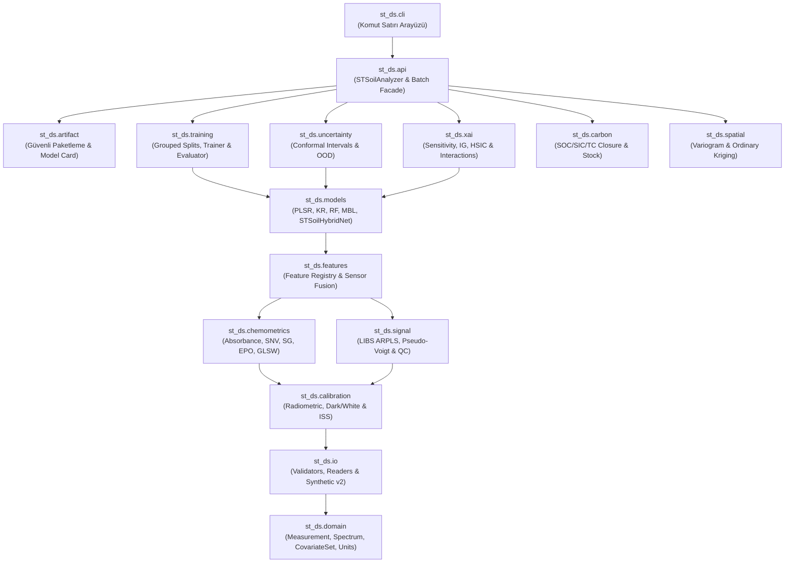

# STDS (`st_ds`) — Faz 0: Mimari Denetim Raporu (Architecture Audit Report)

**Tarih:** 12 Kasım 2026  
**Denetçi Rolü:** STDS Faz 0 Baş Denetçisi (Architecture Auditor)  
**Referans Spesifikasyon:** `STDS_Tam_Sistem_Mimarisi_ve_Fazli_Gelistirme_Plani.pdf` (Sürüm 0.1, 46 Sayfa)  
**Çalışma Dizini:** `/Users/denizhan/Desktop/SpaceTeknopoliDataScience`  
**Çalışma Ortamı Standardı:** Anaconda (`/opt/anaconda3`)

---

## 1. Yönetici Özeti ve Denetim Kapsamı

Bu rapor, **SpaceTeknopoliDataScience (`st_ds`)** projesinin **Faz 0: Repo Audit ve Mimariyi Dondurma** (Spesifikasyon Bölüm 30, Sayfa 32) aşaması kapsamında hazırlanmıştır. Denetimin amacı; kaynak PDF'te adı geçen ilk uygulama parçalarının (`synthetic_csv_builder.py`, `hybrid_soil_net.py`, `trainer.py`, `ChemometricProcessor`, `SoilXAIEngine`, `STSoilAnalyzer`) fiziksel dosya varlığını doğrulamak, Anaconda çalışma ortamını kayıt altına almak, modül durum matrisini (`Implemented` / `Partial` / `Planned` / `Absent`) çıkarmak ve katmanlar arası bağımlılık mimarisini dondurmaktır.

> **Temel Denetim Bulgusu (Kanıt Kuralı):**  
> Spesifikasyon Bölüm 30, Sayfa 32'de belirtilen *"PDF'de kodu gösterilmeyen parçalar bu audit olmadan var kabul edilmez"* ilkesi uyarınca yapılan fiziksel dizin taramasında, çalışma alanında yalnızca mimari planlama PDF'inin bulunduğu tespit edilmiştir. Hiçbir Python kaynak dosyası (`.py`), örnek veri seti (`.csv`), model ağırlık dosyası (`.pt`/`.pth`) veya birim testi (`tests/`) dizinde yer almamaktadır. Bu nedenle tüm yazılım modülleri envanterde **`ABSENT` (Mevcut Değil — Faz 1..11'de Sıfırdan İnşa Edilecek)** olarak sınıflandırılmıştır.

---

## 2. Fiziksel Depo Ağacı ve Dosya Envanteri

### 2.1. Mevcut Çalışma Dizini Ağacı
`12 Kasım 2026` itibarıyla `/Users/denizhan/Desktop/SpaceTeknopoliDataScience` dizin ağacı:

```text
/Users/denizhan/Desktop/SpaceTeknopoliDataScience/
├── STDS_Tam_Sistem_Mimarisi_ve_Fazli_Gelistirme_Plani.pdf   (369,124 byte, 46 sayfa)
└── docs/
    └── faz0/
        ├── architecture_audit_report.md                     (Bu rapor)
        ├── known_defects.md                                 (6 kritik hata ve çözüm planı)
        └── STDS_ARCHITECTURE_DECISIONS.md                   (ADR-001..006 ve açık kararlar)
```

### 2.2. Kaynak PDF'te Adı Geçen İlk Uygulama Dosyalarının Kanıt Denetimi

| Dosya / Bileşen Adı | Kaynak PDF'teki İddia / Referans | Fiziksel Dosya Durumu | Denetim Kararı ve Kanıt Notu |
| :--- | :--- | :--- | :--- |
| `synthetic_csv_builder.py` | Bölüm 2 (Sayfa 4, Satır 5) ve Bölüm 30 (Sayfa 32, Satır 4): Önceki adımda oluşturulduğu söylenmektedir. | **`ABSENT`** | Dizinde dosya yoktur. PDF içinde de kaynak kodu, dağılım parametreleri veya seed mekanizması yer almamaktadır. Faz 2'de (`st_ds/io/synthetic.py`) sıfırdan yazılacaktır. |
| `hybrid_soil_net.py` | Bölüm 2 (Sayfa 4, Satır 6), Bölüm 18 (Sayfa 20) ve Bölüm 30 (Sayfa 32, Satır 4): `STSoilHybridNet` sınıfını barındırdığı belirtilmiştir. | **`ABSENT`** | Dizinde dosya yoktur. PDF Bölüm 18'de yalnızca girdi/çıktı sözleşmesi (`soc_mean`, `sic_mean`, `soc_var`, `class_logits`) tarif edilmiş, katman kodları verilmemiştir. Faz 6'da (`st_ds/models/hybrid_net.py`) inşa edilecektir. |
| `trainer.py` | Bölüm 30 (Sayfa 32, Satır 4) ve Ek D (Sayfa 46, Satır 6): Eğitim döngüsü, kayıp fonksiyonu ve veri bölme yapısı. | **`ABSENT`** | Dizinde dosya yoktur. Faz 6'da (`st_ds/training/trainer.py`) `GroupKFold` ve çok görevli kayıp fonksiyonlarıyla sıfırdan yazılacaktır. |
| `ChemometricProcessor` / `EPO` | Bölüm 2 (Sayfa 4, Satır 5) ve Bölüm 3 (Sayfa 5, Satır 3-13): SNV, Savitzky-Golay 1. türev ve SVD tabanlı EPO taslağı. | **`ABSENT`** | Dizinde dosya yoktur. Taslaktaki matematiksel kusurlar (`DEF-001`, `DEF-002`, `DEF-003`) `known_defects.md` raporunda belgelenmiştir. Faz 4'te (`st_ds/chemometrics/`) temiz mimariyle yazılacaktır. |
| `SoilXAIEngine` | Bölüm 2 (Sayfa 4, Satır 5) ve Bölüm 3 (Sayfa 5, Satır 14-20): RBF kernel HSIC, yerel gradyan önem ve bileşen sıralaması taslağı. | **`ABSENT`** | Dizinde dosya yoktur. Taslaktaki XAI kusurları (`DEF-004`) `known_defects.md` içinde belgelenmiştir. Faz 8'de (`st_ds/xai/`) yeniden inşa edilecektir. |
| `STSoilAnalyzer` | Bölüm 2 (Sayfa 4, Satır 5), Bölüm 3 (Sayfa 5, Satır 21-27) ve Bölüm 25 (Sayfa 27): Dış API facade sınıfı. | **`ABSENT`** | Dizinde dosya yoktur. Taslaktaki güvenlik ve fail-closed ihlalleri (`DEF-005`, `DEF-006`) belgelenmiştir. Faz 10'da (`st_ds/api/analyzer.py`) inşa edilecektir. |
| Örnek CSV / Veri Setleri | Bölüm 18 (Sayfa 20, Satır 16: "Sentetik 10k kayıt") ve Bölüm 30 (Sayfa 32, Satır 5). | **`ABSENT`** | Dizinde `.csv`, `.parquet` veya `.json` veri örneği yoktur. Gerçek laboratuvar referans verisi ve sentetik test verisi Faz 2'de oluşturulacaktır. |
| Model Checkpoint Dosyaları | Bölüm 3 (Sayfa 5, Satır 5) ve Bölüm 30 (Sayfa 32, Satır 5). | **`ABSENT`** | Dizinde `.pt`, `.pth`, `.onnx` veya `.safetensors` uzantılı ağırlık dosyası bulunmamaktadır. |
| Test Paketi (`tests/`) | Bölüm 28 (Sayfa 30) ve Bölüm 30 (Sayfa 32, Satır 5). | **`ABSENT`** | Dizinde hiçbir birim, sözleşme veya entegrasyon testi bulunmamaktadır (%0 test kapsaması). |

---

## 3. Anaconda Çalışma Ortamı ve Kütüphane Envanteri

Projede tüm geliştirme, veri doğrulama, eğitim ve test süreçleri **Anaconda** (`/opt/anaconda3`) üzerinde yürütülecektir. Sistem taramasında tespit edilen ortam ve kütüphane sürümleri aşağıdadır:

### 3.1. Conda Ortamları
| Ortam Adı | Dizin Yolu | Rolü |
| :--- | :--- | :--- |
| `base` | `/opt/anaconda3` | Birincil STDS geliştirme ve doğrulama ortamı (`/opt/anaconda3/bin/python`) |
| `qwen3-tts` | `/opt/anaconda3/envs/qwen3-tts` | Harici ortam (STDS kapsamında kullanılmaz) |

### 3.2. Yüklü Çekirdek Kütüphane Sürümleri (`/opt/anaconda3/bin/python`)
| Kütüphane / Araç | Sürüm | Mimari Uygunluk ve Kullanım Alanı |
| :--- | :--- | :--- |
| **Python** | `3.13.9` (Anaconda, Inc., Clang 20.1.8) | `dataclass`, `Protocol`, `typing` ve modern tip denetimi için tam uyumlu. |
| **NumPy (`numpy`)** | `2.2.6` | Spektral matris işlemleri, SVD (`EPO`/`GLSW`), kovaryans ve vektörel hesaplamalar. |
| **SciPy (`scipy`)** | `1.17.0` | `scipy.signal.savgol_filter`, `scipy.sparse.linalg` (ARPLS baseline), `scipy.optimize` (Pseudo-Voigt pik uydurma), `scipy.spatial.distance`. |
| **PyTorch (`torch`)** | `2.7.1` | `STSoilHybridNet` iki kollu derin ağ, otomatik türev (`autograd`) ile yerel duyarlılık / Integrated Gradients ve güvenli `weights_only=True` yükleme. |
| **Scikit-Learn (`sklearn`)** | `1.6.1` | `PLSRegression` (PLSR), `KernelRidge` (KR), `RandomForestRegressor` (RF), `GroupKFold`, ölçekleyiciler. |
| **Pandas (`pandas`)** | `2.2.3` | CSV/Parquet veri seti okuma-yazma, tablosal meta veri ve alt grup metrik raporlama. |
| **Pydantic (`pydantic`)** | `2.13.5` | Veri sözleşmesi (Schema Validation), canonical birim doğrulama ve JSON serileştirme. |
| **Pytest (`pytest`)** | `8.3.4` | Birim (unit), sözleşme (contract), entegrasyon ve bilimsel regresyon test koşucusu. |

> **Çalıştırma Standardı:** Tüm fazlarda Python ve Pytest çağrıları `/opt/homebrew/bin/python3` yerine açıkça `/opt/anaconda3/bin/python` ve `/opt/anaconda3/bin/pytest` (veya aktif `conda activate base` oturumu) üzerinden yürütülecektir.

---

## 4. STDS Modül Durum Matrisi (`Implemented` / `Partial` / `Planned` / `Absent`)

Spesifikasyon Bölüm 7 (Sayfa 9), Bölüm 29–35 (Sayfa 31–37) ve Ek A (Sayfa 43) uyarınca hedef Python paket mimarisinin (`st_ds/`) mevcut denetim durumu:

| Modül Yolu | Sorumluluk ve Ana Fonksiyon / Sınıflar | Mevcut Durum | Hedef Faz | Kabul Kriteri Özeti |
| :--- | :--- | :--- | :--- | :--- |
| `st_ds/domain/` | `Measurement`, `Spectrum`, `CovariateSet`, `SoilReference`, `PredictionReport`, `QualityFlag`, `InstrumentProfile`, `ArtifactMetadata` | **`ABSENT`** (`Planned`) | Faz 1 | İsimli kanal/kovaryat şeması, canonical birim dönüşümü ve sıkı şema doğrulaması. |
| `st_ds/io/` | CSV/Parquet/JSON okuyucu-yazıcılar, `DatasetManifest`, veri kaynağı (`real` vs `synthetic`) bayrağı, `synthetic_generator_v2` | **`ABSENT`** (`Planned`) | Faz 2 | Veri lineage kontrolü, `sample_id` bütünlüğü, deterministik seed ile sentetik veri üretimi. |
| `st_ds/calibration/` | `calibrate_reflectance`, beyaz/karanlık referans kontrolü, `fit_iss` / `apply_iss`, dalga boyu hizalama | **`ABSENT`** (`Planned`) | Faz 3 | Sıfıra yakın payda/saturasyon maskelemesi, `valid_mask`, `clipping_count` ve referans yaşı kontrolü. |
| `st_ds/signal/` | `filter_libs_shots`, `estimate_arpls_baseline`, `correct_baseline`, `fit_pseudovoigt_peaks`, `aggregate_replicates`, Signal QC | **`ABSENT`** (`Planned`) | Faz 3–4 | LIBS atış QC kuralları, ARPLS taban çizgisi, C I (193.1, 229.7, 247.8 nm) ve H I (656.3 nm) pik çıkarımı. |
| `st_ds/chemometrics/` | `to_absorbance`, `snv_transform`, `savgol_derivative` ($\lambda$ duyarlı), `EPO` (`fit`/`transform`), `GLSW`, dalga boyu harmonizasyonu | **`ABSENT`** (`Planned`) | Faz 4 | `EPO.fit` ve `EPO.transform` aynı uzayda çalışmalı; $\mathbf{P}^\top=\mathbf{P}$ ve $\mathbf{P}^2\approx\mathbf{P}$ testleri geçmeli. |
| `st_ds/features/` | `FeatureRegistry`, `build_feature_vector`, `validate_covariates`, `transform_covariates`, `align_spectral_and_covariates` | **`ABSENT`** (`Planned`) | Faz 5 | Sabit indeks yerine isimli özellik kaydı, eksik kovaryat politikası ve ayrı ölçekleme dalları. |
| `st_ds/models/` | `RegressorProtocol`, `PLSRRegressor`, `KernelRidgeRegressor`, `RandomForestRegressor`, `LocalPLSRRegressor` (MBL), `STSoilHybridNet` | **`ABSENT`** (`Planned`) | Faz 6 | Tek tip tahminci protokolü, negatif karbonu önleyen `softplus` parametrizasyonu. |
| `st_ds/training/` | `grouped_split` (`GroupKFold`/LOSO), `STSoilTrainer`, çok görevli kayıp ($L_{\text{Gaussian}} + L_{\text{CE}} + L_{\text{close}}$), değerlendirme | **`ABSENT`** (`Planned`) | Faz 6 | Aynı parsel/numune tekrarlarının train/test arasında sızmaması, alt grup metrik raporlaması. |
| `st_ds/uncertainty/` | `fit_uncertainty_calibrator`, `predict_interval` (Conformal), `detect_out_of_domain` (OOD), `estimate_ensemble_spread` | **`ABSENT`** (`Planned`) | Faz 7 | Nominal kapsama kalibrasyonu, aleatoric/epistemic ayrımı, eğitim alanı dışı örneklerde OOD uyarısı. |
| `st_ds/xai/` | `local_sensitivity`, `integrated_gradients`, `compute_hsic`, `interaction_score` (mixed partial / SHAP), bileşen sıralaması | **`ABSENT`** (`Planned`) | Faz 8 | $B < 4$ için `insufficient_sample_count`, birim-normalize gradyanlar ve ayrı rapor blokları. |
| `st_ds/carbon/` | `partition_carbon`, `compute_layer_stock`, `compute_profile_stock`, `propagate_stock_uncertainty`, `validate_stock_units` | **`ABSENT`** (`Planned`) | Faz 9 | $\text{TC}=\text{SOC}+\text{SIC}$ kapanış kontrolü, varsayılan `bulk_density` yasağı (`missing_bulk_density`). |
| `st_ds/spatial/` | `fit_variogram`, `ordinary_kriging`, GeoJSON/grid belirsizlik çıktıları (Opsiyonel modül) | **`ABSENT`** (`Planned`) | Faz 9 | Yeterli mekânsal örneklem kontrolü, CRS/projeksiyon doğrulaması ve varyans yüzeyi. |
| `st_ds/artifact/` | `save_artifact`, `load_artifact`, `inspect_artifact`, SHA-256 doğrulama, `model_card.json` | **`ABSENT`** (`Planned`) | Faz 10 | Güvensiz pickle yasağı (`weights_only` / `safetensors`), semantik versiyonlama ve tam pipeline paketi. |
| `st_ds/api/` | `STSoilAnalyzer` (`from_artifact`, `predict`, `predict_batch`, `explain`, `inspect_artifact`), geçiş sarmalayıcısı | **`ABSENT`** (`Planned`) | Faz 10 | Kısmi batch hata toleransı, gizli varsayılanların kaldırılması, JSON-serileştirilebilir `PredictionReport`. |
| `st_ds/cli/` | `st-ds` komut satırı (`dataset validate`, `calibration fit-epo`, `train`, `evaluate`, `artifact inspect`, `predict`, `report export`) | **`ABSENT`** (`Planned`) | Faz 10 | Çekirdek API'yi kullanan ince CLI katmanı, yapılandırılmış hata kodları. |
| `tests/` | `unit/`, `contract/`, `integration/`, `scientific_regression/`, `performance/` | **`ABSENT`** (`Planned`) | Faz 1–11 | Her fazın kabul kapısına bağlı otomatik Pytest doğrulama matrisi. |

---

## 5. Hedef Mimari Bağımlılık Grafiği (Dependency Graph) ve Katman Kuralları

Spesifikasyon Bölüm 5 (Sayfa 7) *"Separation of Concerns"* ve Bölüm 6–7 (Sayfa 8–9) uyarınca modüller arası bağımlılıklar döngüsel olmayan (DAG) katmanlı bir yapıda dondurulmuştur:



### Katman İzolasyon Kuralları:
1. **`st_ds.domain` Sıfır Bağımlılık İlkesi:** `domain` katmanı hiçbir üst katmanı (`models`, `chemometrics`, `api`) import etmez; yalnızca veri şemalarını, birim dönüşüm tablolarını, hata sınıflarını ve protokolleri barındırır.
2. **Donanım ve Sunucu İzolasyonu (ADR-001):** Hiçbir katmanda `serial`, `pyusb`, `smbus`, `fastapi`, `nestjs`, `websocket` veya `psycopg2` bağımlılığı bulunamaz.
3. **Fit ve Transform Ayrımı:** `inference` yolu (`STSoilAnalyzer.predict`) hiçbir koşulda `EPO.fit`, `Scaler.fit` veya `Model.fit` çağıramaz; yalnızca `st_ds.artifact` içinden doğrulanmış parametreleri okur.

---

## 6. Veri Kaynağı ve Referans Etiket Provenans Denetimi

Spesifikasyon Bölüm 2 (Sayfa 4), Bölüm 8 (Sayfa 10) ve Bölüm 19 (Sayfa 21) kapsamında yapılan veri provenans denetimi:
1. **Harici Araştırma Metriklerinin Ayrıştırılması:** Kaynak PDF'te Eylül 2026 Cense Analytics çalışmasına atfedilen $R^2$, $\text{MAE}$ ve $\text{RPIQ}$ değerleri STDS'nin kendi doğrulama sonuçları değildir (Sayfa 4, Paragraf 4). Bu sayılar yalnızca literatür/araştırma referansı olarak kabul edilir; STDS model kartlarında (`model_card.json`) kendi bağımsız holdout sonuçları olarak raporlanamaz.
2. **Referans Etiket Sözleşmesi:** Eğitim ve doğrulama veri setlerine girecek her `SOC`, `SIC` ve `TC` referans ölçümü; laboratuvar metodunu (ör. Kuru yakma / Dumas TC, Kalsimetre / Basınçlı karbonat SIC, Walkley-Black veya asit ön-işlemli yanma SOC), kuru madde esasını (`dry-matter basis`), raporlama birimini (`%` veya `g/kg`) ve laboratuvar ölçüm belirsizliğini zorunlu meta veri olarak taşımalıdır.
3. **Sentetik ve Gerçek Veri Ayrımı:** Faz 2'de üretilecek sentetik spektrumlar `dataset_source="synthetic"` bayrağı taşır ve yalnızca boru hattı (pipeline) doğrulaması ile duman testi (smoke test) için kullanılır; bilimsel model kabul raporlarında gerçek veriyle birleştirilemez.

---

## 7. Faz 0 Gereksinim ve Risk İzlenebilirlik Özeti

| Risk / Gereksinim Kodu | Tanım | İlgili Doküman | Hedef Kapanış Fazı |
| :--- | :--- | :--- | :--- |
| **DEF-001 / Risk 3** | EPO `fit` (raw) ve `transform` (SNV+SG) uzay uyumsuzluğu ve hedef sinyal kaybı | `known_defects.md` (#1), `ADR-003` | Faz 4 |
| **DEF-002** | Savitzky-Golay türevinde dalga boyu ($\Delta\lambda$) yerine sabit indeks (`axis=-1`) kullanımı | `known_defects.md` (#2) | Faz 4 |
| **DEF-003 / Risk 1** | Sabit 24 bant varsayımı ve farklı cihaz profilleriyle uyumsuzluk | `known_defects.md` (#3), `ADR-002` | Faz 1 & Faz 5 |
| **DEF-004 / Risk 7** | XAI HSIC çağrı eksikliği, $B<4$ eşit önem hatası, sahte `coupling_strength`, birim karışıklığı | `known_defects.md` (#4), `ADR-006` | Faz 8 |
| **DEF-005 / Risk 6** | Eksik `bulk_density` için sessiz `1.35` ataması ve eksik kovaryat birim/aralık kontrolleri | `known_defects.md` (#5), `ADR-002` | Faz 1 & Faz 9 |
| **DEF-006 / Risk 8** | Güvensiz pickle tabanlı `torch.load` ve eksik artifact bütünlük kontrolü | `known_defects.md` (#6) | Faz 10 |
| **Risk 2 & Risk 9** | Sentetik veri başarısının veya dış makale metriklerinin saha başarısı sanılması | `architecture_audit_report.md` (§6) | Faz 2 & Faz 11 |
| **Risk 4** | SOC/SIC/TC etiket uyumsuzluğu ve fiziksel kapanış ($\text{TC} = \text{SOC} + \text{SIC}$) ihlali | `ADR-004` | Faz 6 & Faz 9 |
| **Risk 5** | Model belirsizliğinin aşırı iyimser olması ve OOD örneklerde yanlış güven | Mimari Plan Bölüm 20 & 33 | Faz 7 |
